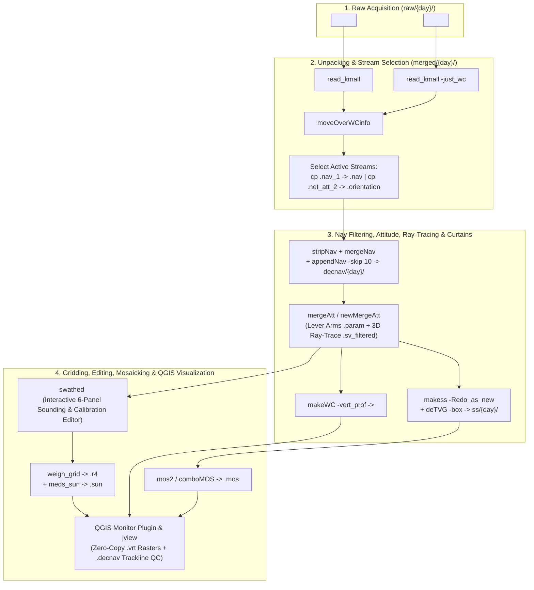

# UNB Ocean Mapping Group (OMG) Multibeam & Acoustic Software Documentation

Welcome to the documentation portal for the **University of New Brunswick (UNB) Ocean Mapping Group (OMG)** multibeam sonar, sidescan, ADCP, scientific echosounder, sub-bottom profiler, and bathymetric LiDAR processing software suite.

Developed across three decades of ocean mapping research, this C/X11/Motif codebase provides **1,000+ specialized command-line tools, interactive editors, and core C libraries** for unpacking, calibrating, ray-tracing, editing, gridding, and mosaicking marine acoustic data—with deep support for **Kongsberg Maritime** systems (`.kmall`, `.kmwcd`, `.all`, `.wcd`, `.raw`), as well as **Teledyne RDI ADCP**, **GeoAcoustics GeoSwath+ / Submetrix 2000**, **Reson SeaBat 7k/8k**, **R2Sonic**, **EdgeTech JSF**, **Klein SDF/XTF**, **Knudsen / SEG-Y**, and **Optech SHOALS LiDAR**.

> [!TIP]
> **New to the OMG Software Suite?** Start with the **[Processing Workflows & Guides](workflows/)**, explore the **[Interactive Tool Finder & Cheat Sheet](usage-guide.html)**, or try the **[Live 349-Line Antarctica (`02_Bransfield`) Survey Monitor](qgis_plugin/bransfield-demo.html)**.

---

## Featured Portals & Interactive Tools

  

    <h3><a href="workflows/">📘 11 Step-by-Step Workflows</a></h3>
    
Complete command-by-command pipelines for Kongsberg <code>.kmall</code> &amp; <code>.all</code> unraveling, bathymetric gridding, sidescan mosaicking, ADCP, EK60/EK80, GeoSwath, and sub-bottom profiling.

    Graduate Student Guides
  

  

    <h3><a href="usage-guide.html">🔍 Interactive Tool Finder &amp; Cheat Sheet</a></h3>
    
Filter OMG executables instantly by file extension (<code>.kmall</code>, <code>.merged</code>, <code>.r4</code>, <code>.sun</code>, <code>.decnav</code>, <code>.ss</code>, <code>.vert_prof</code>), processing stage, or keyword.

    Searchable Directory
  

  

    <h3><a href="qgis_plugin/bransfield-demo.html">🗺️ QGIS Monitor &amp; Live Antarctica Demo</a></h3>
    
Qimera/HIPS-style QGIS 3.x plugin for zero-copy <code>.r4</code>/<code>.sun</code>/<code>.vert_prof</code> rasters and <code>.decnav</code> trackline QC, demonstrated on 349 EM124 lines from Bransfield Strait.

    Interactive Map
  

  

    <h3><a href="llm/">🤖 LocalAI / LLM &amp; RAG Dataset</a></h3>
    
Machine-readable JSON tool schemas (<code>omg_tools_catalog.json</code>) and JSONL instruction/troubleshooting pairs for local AI sonar processing assistants.

    RAG &amp; Fine-Tuning
  

---

## End-to-End Kongsberg `.kmall` & `.kmwcd` Processing Architecture

---

## End-to-End Processing Workflows (`workflows/`)

| Workflow Guide | Sensors & Formats Covered | Key Executables |
| :--- | :--- | :--- |
| **[1. OMG File Formats & Directory Architecture](workflows/file-formats-and-architecture.html)** | `OMG_HDCS` (`.merged`), `JHC_header` (`OMG1`: `.r4`, `.sun`, `.8bit`, `.vert_prof`), `jcu_nav_rec` (`.nav`, `.decnav`), `.orientation`, `.param` | `read_kmall`, `unravel`, `dump_merged`, `head_info`, `check_nav` |
| **[2. Kongsberg `.kmall` & `.kmwcd` Unraveling](workflows/kongsberg-kmall-unraveling.html)** | Kongsberg EM2040, EM712, EM304, EM124 (`.kmall`, `.kmwcd`), multi-day Julian directory layouts (`74..81`) | `read_kmall`, `moveOverWCinfo`, `stripNav`, `mergeNav`, `appendNav`, `mergeAtt`, `newMergeAtt`, `makess`, `deTVG`, `makeWC`, `getBounds` |
| **[3. Kongsberg `.all` & `.wcd` Legacy Unraveling](workflows/kongsberg-all-unraveling.html)** | Kongsberg EM120, EM300, EM302, EM710, EM1002, EM3000 (`.all`, `.wcd`) | `unravel`, `stripNav`, `mergeNav`, `mergeAtt`, `makess`, `makeWC` |
| **[4. Bathymetric Gridding, Swath Editing & Mosaicking](workflows/gridding-and-mosaicking.html)** | `.merged` $\rightarrow$ `.r4`, `.sun`, `.mos`, GeoTIFF / ArcGrid, interactive 3D editing | `weigh_grid`, `meds_sun`, `swathed`, `mos2`, `comboMOS`, `jview`, `r4toESRI`, `r4toTIFF` |
| **[5. Troubleshooting & Diagnostics Reference](workflows/troubleshooting-and-diagnostics.html)** | Roll/pitch/latency wobbles, refraction smiles/frowns, 0-byte `.net_att_2` fallbacks, navigation spikes | `dump_merged`, `dumpFlags`, `check_nav`, `att2ascii`, `DelayEditor`, `swathed` |
| **[6. QGIS & GIS Integration Architecture](workflows/qgis-and-gis-integration.html)** | Zero-copy GDAL `.vrt` wrappers for `.r4`/`.sun`/`.vert_prof`, `.decnav` GeoJSON tracklines | `omg_qgis_cli.py`, `r4toESRI`, `r4toTIFF`, `getBounds` |
| **[7. ADCP Current Processing Workflow](workflows/adcp-processing-workflow.html)** | Teledyne RDI Workhorse / Ocean Surveyor PD0 (`.000`, `.PD0`), tidal current ellipses | `readADCP`, `readWinADCP`, `combineMultiADCP`, `calc_ellipse`, `makeVectorPlot` |
| **[8. Simrad EK60 / EK80 Echosounder Workflow](workflows/ek60-ek80-echosounder-workflow.html)** | Simrad EK500 / EK60 / EK80 (`.raw`), split-beam target strength, sphere calibration | `EKlook`, `BatchProcEK`, `comboCalibEK_ARCs`, `readWave` |
| **[9. GeoSwath & Sidescan Workflows](workflows/geoswath-and-sidescan-workflows.html)** | GeoAcoustics GeoSwath+ / Submetrix 2000 (`.rdf`), Klein `.sdf`, Triton `.xtf`, EdgeTech `.jsf` | `sub2k`, `sub2k_motif`, `debeam`, `destripe`, `nadirdamp`, `glgain` |
| **[10. Multi-Vendor Multibeam Converters](workflows/multibeam-vendor-converters-workflow.html)** | Reson `.s7k`, R2Sonic `.r2s`, WASSP, ELAC, SeaBeam, GSF, XSE, HYPACK, CARIS HIPS | `7k2omg`, `8k2omg`, `r2s2omg`, `gsf2omg`, `xse2omg`, `refoELAC` |
| **[11. Sub-Bottom Profiler & Bathymetric LiDAR](workflows/subbottom-and-lidar-workflows.html)** | SEG-Y (`.sgy`), Knudsen Chirp (`.keb`), EdgeTech Chirp (`.jsf`), Optech SHOALS LiDAR | `segy`, `knudsen`, `jsf`, `Optech`, `glseis` |

---

## Browse Codebase Documentation by Domain Category

All **68 source directories** (`1,050+` documented tools, C sources, and headers) are organized into **5 logical domain categories** in the left sidebar:

| Domain Category | Directories Included |
| :--- | :--- |
| **[1. Multibeam Unpacking, Nav & Ray-Tracing](categories/multibeam-core.html)** | [`kmall`](kmall/), [`omg`](omg/), [`nav`](nav/), [`att`](att/), [`ray`](ray/), [`RTLite`](RTLite/), [`RT`](RT/), [`tide`](tide/), [`Tidecor`](Tidecor/), [`QC`](QC/) |
| **[2. Gridding, Mosaicking & Interactive Editors](categories/gridding-and-viz.html)** | [`grid`](grid/), [`newmos`](newmos/), [`SE`](SE/), [`JV`](JV/), [`DE`](DE/), [`image`](image/), [`plot`](plot/), [`cmaps`](cmaps/), [`gl`](gl/), [`glseis`](glseis/), [`bpdemo`](bpdemo/) |
| **[3. Sidescan, Echosounders, ADCP & Sub-Bottom](categories/sidescan-and-acoustics.html)** | [`sidescan`](sidescan/), [`EKlook`](EKlook/), [`Wave`](Wave/), [`adcp`](adcp/), [`class`](class/), [`segy`](segy/), [`knudsen`](knudsen/), [`jsf`](jsf/), [`xtf`](xtf/), [`sdf`](sdf/), [`mr1`](mr1/), [`singlebeam`](singlebeam/) |
| **[4. Multi-Vendor Sonar & LiDAR Converters](categories/vendor-converters.html)** | [`reson`](reson/), [`Sbat`](Sbat/), [`r2sonic`](r2sonic/), [`wassp`](wassp/), [`elac`](elac/), [`sb2k`](sb2k/), [`sub2k`](sub2k/), [`sub2k_motif`](sub2k_motif/), [`M3`](M3/), [`mb1`](mb1/), [`humm`](humm/), [`xse`](xse/), [`gsf`](gsf/), [`hypack`](hypack/), [`hips_goodies`](hips_goodies/), [`Optech`](Optech/), [`ROSS`](ROSS/), [`netcdf`](netcdf/) |
| **[5. Core Libraries, Researcher Suites & Utilities](categories/libraries-and-utilities.html)** | [`subr`](subr/), [`subr_graphics`](subr_graphics/), [`plotlib`](plotlib/), [`gsf_lib`](gsf_lib/), [`shapelib-1.3.0a2`](shapelib-1.3.0a2/), [`ianc`](ianc/), [`jonnyb`](jonnyb/), [`james`](james/), [`steve`](steve/), [`bin`](bin/), [`scripts`](scripts/), [`misc-tools`](misc-tools/), [`line`](line/), [`vers`](vers/), [`tests`](tests/), [`labs`](labs/), [`howto`](howto/), [`doc`](doc/), [`wiki`](wiki/) |
