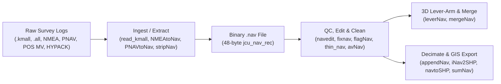

# Navigation Tools (`code/nav/`)

The `code/nav/` suite comprises **35 command-line utilities** for ingesting, filtering, editing, lever-arm translating, merging, and exporting vessel and vehicle navigation data across the Ocean Mapping Group (OMG) processing pipeline.

---

## The Binary `.nav` Architecture (`jcu_nav_rec`)

All tools in `code/nav/` operate around the fixed-length **48-byte binary navigation record** (`jcu_nav_rec`, defined in `code/subr/jcu_nav.h` with `JCU_BINNAV_RECLEN = 48`). Because every record is exactly 48 bytes in big-endian/swapped on-disk format (`nav_read()` / `nav_write()` in `code/subr/jcu_nav.c`), utilities can determine record counts instantaneously from file size (`ftell(fp) / 48`) and perform $O(\log N)$ binary time searches (`nav_time_search_double()`).

| Byte Offset | C Type | Field Name | Units / Convention | Description |
|---|---|---|---|---|
| `0..7` | `double` | `lat` | Decimal degrees (+N / -S) | WGS84 Latitude |
| `8..15` | `double` | `lon` | Decimal degrees (+E / -W) | WGS84 Longitude |
| `16..19` | `int` | `time` | Seconds since Jan 1, 1970 | Integer UTC Unix epoch timestamp |
| `20..21` | `short` | `centisecs` | $0..99$ ($0.01\text{ s}$) | Sub-second timestamp resolution ($t = \text{time} + \text{centisecs}/100.0$) |
| `22..23` | `short` | *(padding)* | — | 2-byte alignment padding in on-disk 48-byte record |
| `24..27` | `float` | `azi` | Degrees ($0..360^\circ$) or Meters | Vessel heading/course over ground, **or** antenna ellipsoid height (for RTK/`leverNav`), **or** current/wind flow direction |
| `28..31` | `float` | `velocity` | $\text{m/s}$ (or knots) | Vessel speed over ground, **or** current/wind speed |
| `32..33` | `short` | `depth` | Meters / mm / code | Towfish depth, altitude, or scaled height |
| `34..35` | `short` | `flag[0]` | Integer count | Satellite count (`SVs`) or primary sensor status |
| `36..37` | `short` | `flag[1]` | Integer code | GPS fix quality / differential / RTK mode (evaluated by [`flagNav`](flagNav.html)) |
| `38..39` | `short` | `flag[2]` | Scaled integer | PDOP or HDOP ($\times 10$ or $\times 100$) |
| `40..41` | `short` | `flag[3]` | `0` = Good, `1` = Bad | **Master validity flag** (`0` = accepted by [`mergeNav`](mergeNav.html) and [`appendNav -goodonly`](appendNav.html); `1` = rejected) |

---

## Standard Navigation Workflows

1. **Multibeam Unraveling Pipeline (`.kmall` / `.all`):**
   * `read_kmall` or `read_all` extracts raw positioning sensor telegrams into `<line>.nav_1`, `.nav_2`, etc., and attitude into `<line>.orientation_1`.
   * [`mergeAtt`](../omg/mergeAtt.html) merges roll, pitch, heave, and heading onto `<line>.merged` first.
   * [`mergeNav`](mergeNav.html) interpolates `<line>.nav` onto `<line>.merged` with 3D lever-arm rotation (`-ahead`, `-right`, `-below`, or `-use_params`).
   * [`appendNav -skip 10`](appendNav.html) writes a decimated trackline (`decnav/<subdir>/<line>.decnav`) for rapid plotting in `jview`.
2. **External RTK / Post-Processed Navigation Replacement:**
   * Convert external trajectory logs to `.nav` using [`NMEAtoNav`](NMEAtoNav.html), [`PNAVtoNav`](PNAVtoNav.html), [`QNSYtoNav`](QNSYtoNav.html), or [`Generic_to_Nav`](Generic_to_Nav.html).
   * Check for time jumps and filter bad quality fixes using [`navedit -check`](navedit.html), [`fixnav`](fixnav.html), [`thin_nav -by_time`](thin_nav.html), and [`flagNav`](flagNav.html).
   * Translate antenna RTK height/position to the vessel Reference Point with [`leverNav`](leverNav.html) or merge directly onto `.merged` with [`mergeNav -nav <new.nav>`](mergeNav.html).

---

## Categorized Tool Reference (All 35 Tools)

### 1. Core Multibeam / Sidescan Pipeline & Lever-Arm Tools

| Tool | Source File | Description |
|---|---|---|
| [`mergeNav`](mergeNav.html) | `code/nav/mergeNav.c` | Interpolates binary `.nav` records onto `.merged`, `.ss`, `.svp`, or `.adcp` files with 3D lever-arm rotation (`-ahead`, `-right`, `-below`, `-use_params`) and latency correction (`-delay`). |
| [`stripNav`](stripNav.html) | `code/nav/stripNav.c` | Extracts ping timestamps, vessel positions, outer-beam footprints (`-port`, `-stbd`, `-zigzag`), or attitude/tide/backscatter series from `.merged` or `.ss` files into `.nav` or ASCII format. |
| [`appendNav`](appendNav.html) | `code/nav/appendNav.c` | Concatenates, decimates (`-skip`), chronologically sorts (`-presortnav`), clips (`-area`, `-region`, `-timeboundsof`), bins by tidal phase (`-tide_phase_sort`), and exports `.nav` files to `.decnav`, ASCII, CSV, or Google Earth KML (`-kmlpath`). |
| [`appendNav_asciiSecs`](appendNav_asciiSecs.html) | `code/nav/appendNav_asciiSecs.c` | Specialized variant of `appendNav` that formats ASCII output timestamps with floating-point seconds. |
| [`leverNav`](leverNav.html) | `code/nav/leverNav.c` | Translates 3D antenna coordinates (lat, lon, and ellipsoid height stored in `azi`) to the vessel Reference Point (`<prefix>.nav.at_RP`) using roll, pitch, and heading from `<prefix>.orientation*`. |
| [`embedNav`](embedNav.html) | `code/nav/embedNav.c` | Rasterizes binary `.nav` or ASCII tracklines and center-fix ticks directly into an OMG1 raster image grid. |

### 2. Quality Control, Filtering, Smoothing & Diagnostics

| Tool | Source File | Description |
|---|---|---|
| [`navedit`](navedit.html) | `code/nav/navedit.c` | Interactive `.nav` record browser/editor and batch diagnostic tool (`-check` for $\Delta t$ and negative time jump analysis, `-fix_midnight` for 24-hr rollover repair, `-show_centre_fix`). |
| [`fixnav`](fixnav.html) | `code/nav/fixnav.c` | Detects and repairs backward day/time jumps in binary `.nav` files (originally built for legacy EM100 telegram rollovers). |
| [`flagNav`](flagNav.html) | `code/nav/flagNav.c` | Evaluates GPS quality indicator `flag[1]` against `-accept <min>` in-place and sets master validity flag `flag[3]` (`0` = accept, `1` = reject). |
| [`filtnav`](filtnav.html) | `code/nav/filtnav.c` | Interactive outlier filter and day-constraint cleaner for binary `.nav` files. |
| [`thin_nav`](thin_nav.html) | `code/nav/thin_nav.c` | Thins a `.nav` file into `<filename>_thin` by removing consecutive duplicate positions (default) or enforcing strictly increasing timestamps (`-by_time`). |
| [`removeRedundantNav`](removeRedundantNav.html) | `code/nav/removeRedundantNav.c` | Concatenates `.nav` files into `-comp` while dropping consecutive duplicate lat/lon fixes or rejecting forward/backward time jumps exceeding `-reject_timejump_over <sec>`. |
| [`avNav`](avNav.html) | `code/nav/avNav.c` | Smooths noisy navigation or tide `.nav` records using a moving boxcar average (`-nosmooth`), cosine taper window (`-cos_taper`), or median filter (`-median`). |
| [`calcSpeedHead`](calcSpeedHead.html) | `code/nav/calcSpeedHead.c` | Recomputes vessel speed over ground (`velocity`) and course over ground (`azi`) from first differences of $(\text{lat}, \text{lon}, t)$ in-place, or flags anomalous velocity/time steps (`-check`). |
| [`sumNav`](sumNav.html) | `code/nav/sumNav.c` | Computes total survey trackline distance (km) and duration (minutes/hours/days) across binary `.nav` files or planned ASCII waypoint lines (`-ascii -speed_knots`). |
| [`dumpnav`](dumpnav.html) | `code/nav/dumpnav.c` | Lightweight ASCII dumper that extracts time (`-1970` or `-jday`) and position/speed/azimuth/depth from a binary `.nav` file. |

### 3. External Format Converters (ASCII / Telemetry to `.nav`)

| Tool | Source File | Description |
|---|---|---|
| [`NMEAtoNav`](NMEAtoNav.html) | `code/nav/NMEAtoNav.c` | Parses raw NMEA-0183 serial logs (`$GPGGA`, `$GNGGA`, `$INGGA`, `$GPGLL`, `$PTNL,GGK`, `$GPVTG`, `$GPZDA`) into binary `.nav` files. |
| [`PNAVtoNav`](PNAVtoNav.html) | `code/nav/PNAVtoNav.c` | Converts Ashtech PNAV ASCII exports, NavLab binary trajectories, POS MV exports, and CTD/water-column files into binary `.nav` and `.orientation` files. |
| [`toNav`](toNav.html) | `code/nav/toNav.c` | Converts fixed-width (125-byte or `-new` 105-byte) Ashtech PNAV post-processed GPS files into binary `.nav` format with satellite count, PDOP, and solution flags. |
| [`QNSYtoNav`](QNSYtoNav.html) | `code/nav/QNSYtoNav.c` | Converts QPS QINSY ASCII navigation, motion, speedlog, and draught exports into binary `.nav` and `.orientation` files. |
| [`Generic_to_Nav`](Generic_to_Nav.html) | `code/nav/Generic_to_Nav.c` | Multi-format ASCII parser supporting Marine Institute environmental logs (`-MI_env_data`), Star-Oddi Starmon TD loggers, MarineTraffic AIS tracks, and BGS shapefile extracts. |
| [`hypack2nav`](hypack2nav.html) | `code/nav/hypack2nav.c` | Parses HYPACK `.RAW` survey logs (`TND` date headers and `RAW` position sentences) into 1-Hz binary `.nav` files. |
| [`dohypackLNW`](dohypackLNW.html) | `code/nav/dohypackLNW.c` | Converts between HYPACK planned line files (`.LNW`, in UTM meters) and OMG planned line files (`-jhc2hy`, `-hy2jhc`). |
| [`readISS_ASCII`](readISS_ASCII.html) | `code/nav/readISS_ASCII.c` | Parses ISS-60 `.d01` weather files (`-iss_wea` $\rightarrow$ binary `.Wind`) and sea-surface temperature / sound velocity logs (`-iss_sst` $\rightarrow$ ASCII `.SST`, `.SSV1`, `.SSV2`). |
| [`AGCtoNav`](AGCtoNav.html) | `code/nav/AGCtoNav.c` | Converts Atlantic Geoscience Centre (AGC), OIC (`-oicnav`), JGSPEC, DAPSY, and NRL ASCII navigation formats into binary `.nav` files. |
| [`AuketoNav`](AuketoNav.html) | `code/nav/AuketoNav.c` | Converts Trimble Geomatics Office (TGO) custom ASCII navigation and Peter Stewart modified heave files into binary `.nav` format. |
| [`NJWtoNav`](NJWtoNav.html) | `code/nav/NJWtoNav.c` | Converts NJW SSP ASCII navigation logs into binary `.nav` format. |
| [`DNMtoLLD`](DNMtoLLD.html) | `code/nav/DNMtoLLD.c` | Unpacks Royal Australian Navy Division of National Mapping (DNM) telegrams into `lat lon depth` records. |
| [`sar2Nav`](sar2Nav.html) | `code/nav/sar2Nav.c` | Converts NASA/JPL AIRSAR airborne radar ASCII flight logs into binary `.nav` format. |
| [`video2Nav`](video2Nav.html) | `code/nav/video2Nav.c` | Splits USGS VISOE ASCII seabed camera drift tracks (`END <drift_id>`) into individual binary `.nav` files. |
| [`xsonar2Nav`](xsonar2Nav.html) | `code/nav/xsonar2Nav.c` | Converts USGS XSONAR ASCII sidescan navigation logs (`day hour min sec latdeg latmin londeg lonmin`) into binary `.nav` format given `-year <YYYY>`. |

### 4. ESRI Shapefile & GIS Interoperability Tools

| Tool | Source File | Description |
|---|---|---|
| [`iNav2SHP`](iNav2SHP.html) | `code/nav/iNav2SHP.c` | Full-featured Shapelib converter that exports binary `.nav` tracks, `sortCont` ASCII contours (`-ascii`), or OMG1 mapsheet bounds (`-map`) to 3D `.shp`, `.shx`, `.dbf`, and WGS84 `.prj` files. |
| [`navtoSHP`](navtoSHP.html) | `code/nav/navtoSHP.c` | Lightweight converter that exports a binary `.nav` file to a 2D polyline `.shp` and `.shx` pair using `j_SHP.c`. |
| [`makeDBF`](makeDBF.html) | `code/nav/makeDBF.c` | Creates a companion dBASE III (`.dbf`) attribute table with a clickable `HYPERLINK` column (`-url`) for `.shp`/`.shx` tracklines produced by `navtoSHP`. |
| [`readSHP`](readSHP.html) | `code/nav/readSHP.c` | Inspects `.shp`/`.shx` headers and exports Shapefile geometries (with optional UTM-to-WGS84 unprojection via `-merid`) to OMG ASCII contour/segment format or binary `.nav` (`-navbin`). |
