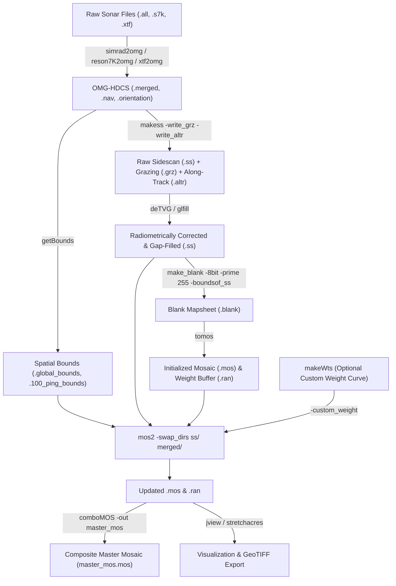

# Sidescan & Backscatter Mosaicking (`newmos/`)

The `code/newmos/` directory contains the Ocean Mapping Group's **acoustic backscatter and sidescan mosaicking suite**. These tools project georeferenced GLORIA-format `.ss` sidescan time series (generated from multibeam snippets/seabed image datagrams or towed sidescan sonars via [`makess`](../omg/makess.md) and gap-filled via [`glfill`](../sidescan/hist/glfill.md)), OMG-HDCS `.merged` per-beam reflectivity records, or Hawaii MR1 sidescan files onto 8-bit `JHC_header` raster mapsheets (`.mos`), using companion priority-weight buffers (`.ran`) to automatically seam overlapping swaths.

---

## Tools & Modules in `newmos/`

| Tool / Module | Source File | Role in the Mosaicking Pipeline |
|---|---|---|
| [`mos2`](mos2.md) | `code/newmos/mos2.c` | **Primary Backscatter Mosaicking Engine**: Projects `.ss` sidescan swaths (`-gloria`), `.merged` beam amplitudes (`-beam` with `-refl`, `-aibs`, or `-calb`), or `.mr1` lines onto `<mosprefix>.mos`. Supports across-track priority-weight autoseaming in `<mosprefix>.ran`, dynamic grazing-angle weighting (`-weight_by_angle <.grz>`), yaw/deep-water along-track sample offsets (`-apply_along_track <.altr>`), pulse-length DN balancing (`-pulselenDNshift`), and spatial bounds acceleration (`-swap_dirs`). |
| [`comboMOS`](comboMOS.md) | `code/newmos/comboMOS.c` | **Multi-Mosaic Weight Compositor**: Combines up to 5,000 co-registered `<line_or_block>.mos` and `.ran` mapsheets into a master `<comboprefix>.mos` and `.ran` by retaining the pixel with the highest priority (smallest `.ran` value `< 255`) at every grid node. Supports per-mosaic `.shifts` DN adjustments (`-use_shifts`) and seam ownership maps (`-paint_frame`). |
| [`fillquad2`](fillquad2.md) | `code/newmos/fillquad2.c` | **Bresenham Quadrilateral Scan-Converter**: Linked directly into `mos2` (`fill_quad2()`). Rasterizes and Gouraud-interpolates the 4-corner quadrilateral formed by adjacent across-track samples between consecutive pings using pure integer Bresenham arithmetic. |
| [`makeWts`](makeWts.md) | `code/newmos/makeWts.c` | **Interactive Custom Weight Curve Generator**: Builds piecewise-linear across-track priority weight tables (`MOS_weights`, up to 2,048 samples) for `mos2 -custom_weight` (`0` = highest priority, `255` = lowest priority) or `weigh_grid` (`-grid`, `1.0` = highest, `0.0` = lowest). |
| [`rasterCoords`](rasterCoords.md) | `code/newmos/rasterCoords.c` | **Legacy Raster Graticule & Vector Overlay Routines**: Reference functions (`MosaicGrid`, `Draw_Line`, `DrawVectors`, `dmsstring`) from the original JCU `mosaic` program for burning coordinate ticks, `afont` border labels, and ASCII vector polylines into `.mos`/`.ran` caches. |

---

## End-to-End Backscatter Mosaicking Pipeline

### Key Companion Tools Outside `newmos/`
* [`make_blank`](../grid/make_blank.md) — Creates the initial 8-bit `.blank` mapsheet header and raster (`make_blank -8bit -prime 255 <prefix> -boundsof_ss ss/*.ss`).
* [`tomos`](../scripts/tomos.md) — Shell script that copies `<prefix>.blank` to both `<prefix>.mos` and `<prefix>.ran` prior to running `mos2`.
* [`makess`](../omg/makess.md) — Extracts 1024-sample GLORIA `.ss` sidescan files (plus optional `.grz` grazing angle and `.altr` along-track offset files) from `.merged` and raw sonar packets.
* [`glfill`](../sidescan/hist/glfill.md) & [`deTVG`](../sidescan/hist/deTVG.md) — Interpolates across-track gaps and removes empirical Time-Varied Gain / angular response artifacts in `.ss` files before mosaicking.
* [`jview`](../viz/jview.md) — Interactive X11 viewer for inspecting `.mos` backscatter mosaics and `.ran` autoseam weight buffers.
