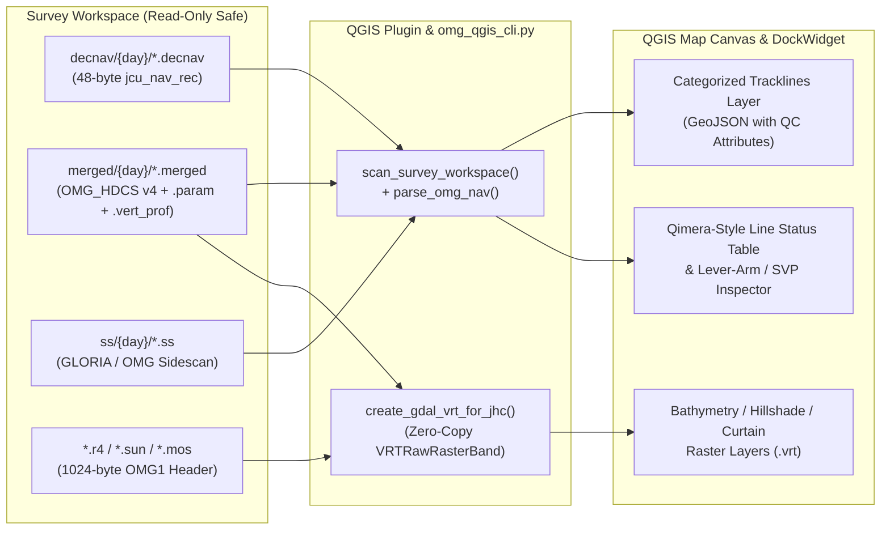

# OMG Multibeam Survey & Processing Monitor — QGIS Plugin (QGIS 3.x & 4.x)

The **OMG Multibeam Survey & Processing Monitor** is a native **QGIS 3.x (Qt5) and QGIS 4.x (Qt6, including 4.2.3) Plugin** and standalone headless CLI (`omg_qgis_cli.py`) that provides a **Qimera / CARIS HIPS-style Project & Processing Monitor** directly inside QGIS for UNB Ocean Mapping Group survey workspaces.

<div style="background: #1e293b; border: 1px solid #38bdf8; border-radius: 8px; padding: 1rem 1.25rem; margin: 1rem 0 1.5rem 0; display: flex; flex-wrap: wrap; justify-content: space-between; align-items: center; gap: 1rem;">
  <div>
    <div style="font-weight: 700; font-size: 1rem; color: #f8fafc;">📦 Download Plugin Package for QGIS ("Install from ZIP")</div>
    <div style="font-size: 0.85rem; color: #cbd5e1;">Compatible with <strong>QGIS 4.2.3 (Qt6)</strong> and <strong>QGIS 3.22+ (Qt5)</strong> on Windows, Linux, and macOS.</div>
  </div>
  <div style="display: flex; gap: 0.75rem;">
    <a href="omg_qgis_plugin.zip" download style="background: #0284c7; color: #ffffff; padding: 0.55rem 1.1rem; border-radius: 6px; font-weight: 600; text-decoration: none; font-size: 0.9rem;">⬇ Download omg_qgis_plugin.zip</a>
    <a href="bransfield-demo.html" style="background: #334155; color: #38bdf8; padding: 0.55rem 1.1rem; border-radius: 6px; font-weight: 600; text-decoration: none; font-size: 0.9rem;">🌐 View Antarctica Live Demo</a>
  </div>
</div>

---

## Installing in QGIS 4.2.3 (or QGIS 3.x) via "Install from ZIP"

1. Grab the packaged ZIP file from either:
   - **Direct Web Download:** [**`omg_qgis_plugin.zip`**](https://ocean-mapping-group.github.io/qgis_plugin/omg_qgis_plugin.zip)
   - **Local Workspace Path (WSL / Linux):** `/home/iwc/coding/omg_qgis_plugin.zip` (accessible from Windows File Explorer at `\\wsl.localhost\Ubuntu\home\iwc\coding\omg_qgis_plugin.zip` or `\\wsl$\Ubuntu\home\iwc\coding\omg_qgis_plugin.zip`)
2. Open **QGIS 4.2.3** and go to **Plugins $\rightarrow$ Manage and Install Plugins...**
3. Select the **Install from ZIP** tab on the left.
4. Click the **`...`** browse button, select **`omg_qgis_plugin.zip`**, and click **Install Plugin**.
5. Once installed, click the **OMG Multibeam Monitor** sonar icon on the QGIS toolbar (or open **Raster $\rightarrow$ OMG Multibeam Monitor**).
6. In the dock widget at the right:
   - Set **Survey Workspace** to `W:\data\2026_Antarctica\OMG_Care2026\02_Bransfield` (or click **Browse...**).
   - Leave **Local Output/VRT Cache Dir** set to your local folder (so `W:` is never written to).
   - Click **Scan Workspace**, then click **Plot / Update Tracklines on QGIS Map** to display all 349 multibeam lines colored by **Julian Day (`74`–`81`)** or **Processing Stage**.

---

## Key Capabilities

1. **Zero-Copy GDAL Virtual Raster (`.vrt`) Loader for OMG Rasters (`.r4`, `.sun`, `.8bit`, `.mos`, `.weight`, `.vert_prof`):**
   - Reads the 1024-byte big-endian `JHC_header` (`"OMG1"` magic bytes at offset `0`, raster payload at offset `1024` or `2048` for `.vert_prof` water column curtains).
   - Computes the exact `EPSG` / `PROJ.4` coordinate reference system (UTM Zone North/South, Mercator, Geographic, or Curtain Grid) and 6-parameter affine `GeoTransform`.
   - Generates a lightweight XML `.vrt` (`VRTRawRasterBand` with `ByteOrder=MSB`) so QGIS renders multi-gigabyte `.r4` floating-point bathymetry grids, `.sun` hillshades, `.mos` backscatter mosaics, and `.vert_prof` water column curtains **instantly without duplicating or converting binary data**.
   - **Master Archive Safety (`--output-dir`):** When inspecting read-only master archives (e.g., `W:\data\...`), all `.vrt` and `.geojson` files are written to a local cache/output directory so zero files on the archive drive are modified.

2. **Qimera / HIPS-Style Survey Line Processing Stage Matrix:**
   - Scans both **flat** (`raw/`, `merged/`, `decnav/`, `ss/`) and **Julian-Day partitioned** (`raw/74/`, `merged/74/`, `decnav/74/`, `ss/74/`) survey workspaces.
   - Displays a real-time per-line checklist showing:
     - **Line ID & Julian Day** (`74/0029_20260315_042139_Almirante_Viel`)
     - **Pipeline Stage Badge:**
       - `COMPLETE (Bathy + WC + Nav + Att + SS)` (Green)
       - `COMPLETE (Bathy + Nav + Att + SS)` (Teal)
       - `BATHY READY (Nav + Att Merged)` (Amber — flags missing `.ss` or halted `mergeAtt`)
       - `UNPACKED (Pending Att / Ray-Trace)` (Blue)
       - `RAW ONLY (Not Unravelled)` (Red)
     - **Component Matrix:** `Raw`, `Merged`, `Nav`, `DecNav`, `Att`, `SVP`, `SS`, `WC (.vert_prof)`
     - **Swath Metadata:** Ping count, beam count, min/max depth (`m`), mean speed (`kts`), mean heading (`°`), and installation lever arms (`.param` / `.param_km`).

3. **Direct Binary `.decnav` / `.nav` Trackline & `.merged` Footprint Generation:**
   - Parses 48-byte big-endian `jcu_nav_rec` records (`42` payload bytes `>ddihhffhhhhh` + `6` alignment pad bytes) from `decnav/` or `merged/*.nav` in ~0.15 seconds across 350+ lines.
   - Loads color-coded `LineString` tracklines into the QGIS Map Canvas categorized by **Pipeline Stage** or **Julian Day**.

---

## Architecture & Data Flow



---

## Headless Command-Line Usage (`omg_qgis_cli.py`)

You can scan any survey directory, generate a QGIS-ready trackline GeoJSON, and build zero-copy `.vrt` rasters from the terminal without opening the QGIS GUI:

```bash
python3 qgis_plugin/omg_qgis_cli.py \
  --workspace /mnt/w/data/2026_Antarctica/OMG_Care2026/02_Bransfield \
  --output-dir ./bransfield_qgis_outputs \
  --export-geojson ./bransfield_qgis_outputs/bransfield_tracklines.geojson \
  --stride 1
```
