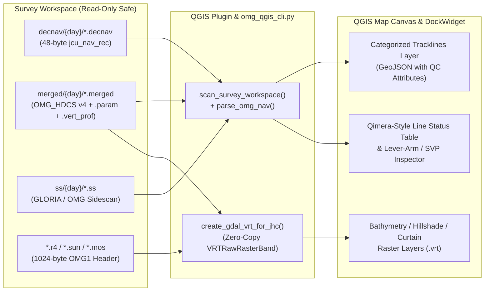

# OMG Multibeam Survey & Processing Monitor — QGIS Plugin

The **OMG Multibeam Survey & Processing Monitor** is a native **QGIS 3.x Plugin** and standalone headless CLI (`omg_qgis_cli.py`) that provides a **Qimera / CARIS HIPS-style Project & Processing Monitor** directly inside QGIS for UNB Ocean Mapping Group survey workspaces.

> [!TIP]
> **Explore the Live Antarctica (`02_Bransfield`) Survey Demo:** See **[Antarctica (02_Bransfield) Live Demo](bransfield-demo.html)** or open the **[Full-Screen Interactive 349-Line Map](assets/bransfield_interactive_map.html)** to inspect 349 Kongsberg EM124 multibeam lines processed from RV *Almirante Viel*.

---

## Key Capabilities

1. **Zero-Copy GDAL Virtual Raster (`.vrt`) Loader for OMG Rasters (`.r4`, `.sun`, `.8bit`, `.mos`, `.weight`, `.vert_prof`):**
   - Reads the 1024-byte big-endian `JHC_header` (`"OMG1"` magic bytes at offset `0`, raster payload at offset `1024` or `2048` for `.vert_prof` water column curtains).
   - Computes the exact `EPSG` / `PROJ.4` coordinate reference system (UTM Zone North/South, Mercator, Geographic, or Curtain Grid) and 6-parameter affine `GeoTransform`.
   - Generates a lightweight XML `.vrt` (`VRTRawRasterBand` with `ByteOrder=MSB`) so QGIS renders multi-gigabyte `.r4` floating-point bathymetry grids, `.sun` hillshades, `.mos` backscatter mosaics, and `.vert_prof` water column curtains **instantly without duplicating or converting binary data**.
   - **Master Archive Safety (`--output-dir`):** When inspecting read-only master archives (e.g., `W:\data\...`), all `.vrt` and `.geojson` files are written to a local cache/output directory so zero files on the archive drive are modified.

2. **Qimera / HIPS-Style Survey Line Processing Stage Matrix:**
   - Scans both **flat** (`raw/`, `merged/`, `decnav/`, `ss/`) and **Julian-Day partitioned** (`raw/74/`, `merged/74/`, `decnav/74/`, `ss/74/`) survey workspaces.
   - Displays a real-time per-line checklist showing:
     - **Line ID & Julian Day** (`74/0029_20260315_042139_Almirante_Viel`)
     - **Pipeline Stage Badge:**
       - `COMPLETE (Bathy + WC + Nav + Att + SS)` (Green)
       - `COMPLETE (Bathy + Nav + Att + SS)` (Teal)
       - `BATHY READY (Nav + Att Merged)` (Amber — flags missing `.ss` or halted `mergeAtt`)
       - `UNPACKED (Pending Att / Ray-Trace)` (Blue)
       - `RAW ONLY (Not Unravelled)` (Red)
     - **Component Matrix:** `Raw`, `Merged`, `Nav`, `DecNav`, `Att`, `SVP`, `SS`, `WC (.vert_prof)`
     - **Swath Metadata:** Ping count, beam count, min/max depth (`m`), mean speed (`kts`), mean heading (`°`), and installation lever arms (`.param` / `.param_km`).

3. **Direct Binary `.decnav` / `.nav` Trackline & `.merged` Footprint Generation:**
   - Parses 48-byte big-endian `jcu_nav_rec` records (`42` payload bytes `>ddihhffhhhhh` + `6` alignment pad bytes) from `decnav/` or `merged/*.nav` in ~0.15 seconds across 350+ lines.
   - Loads color-coded `LineString` tracklines into the QGIS Map Canvas categorized by **Pipeline Stage** or **Julian Day**.

---

## Architecture & Data Flow



---

## Installation in QGIS 3.x

1. Copy or symlink [`qgis_plugin/omg_qgis_plugin/`](https://github.com/ocean-mapping-group/ocean-mapping-group.github.io/tree/master/qgis_plugin/omg_qgis_plugin) into your QGIS Python plugins directory:
   - **Linux:** `~/.local/share/QGIS/QGIS3/profiles/default/python/plugins/omg_qgis_plugin`
   - **Windows:** `%APPDATA%\QGIS\QGIS3\profiles\default\python\plugins\omg_qgis_plugin`
   - **macOS:** `~/Library/Application Support/QGIS/QGIS3/profiles/default/python/plugins/omg_qgis_plugin`
2. In QGIS, open **Plugins $\rightarrow$ Manage and Install Plugins...**, enable **OMG Multibeam Survey & Processing Monitor**, and click the **OMG Monitor** toolbar button.

---

## Headless Command-Line Usage (`omg_qgis_cli.py`)

You can scan any survey directory, generate a QGIS-ready trackline GeoJSON, and build zero-copy `.vrt` rasters from the terminal without opening the QGIS GUI:

```bash
python3 qgis_plugin/omg_qgis_cli.py \
  --workspace /mnt/w/data/2026_Antarctica/OMG_Care2026/02_Bransfield \
  --output-dir ./bransfield_qgis_outputs \
  --export-geojson ./bransfield_qgis_outputs/bransfield_tracklines.geojson \
  --stride 1
```
