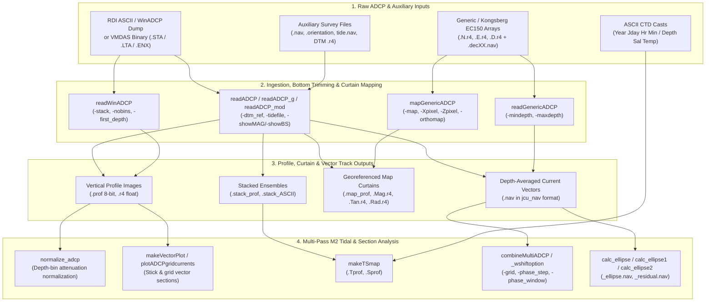

# ADCP Processing & Tidal Current Analysis Workflow

The Ocean Mapping Group (OMG) `adcp/` and `grid/` toolsets provide an end-to-end processing pipeline for shipboard and vessel-mounted **Acoustic Doppler Current Profiler (ADCP)** datasets. Originally developed around Teledyne RD Instruments (RDI) Workhorse, Ocean Surveyor, and Broadband ADCPs—and later extended to Kongsberg EC150 and generic NetCDF-derived 3D velocity arrays—the workflow integrates vessel navigation, high-rate attitude, tidal height predictions, and high-resolution multibeam digital terrain models (DTMs) to produce:

1. **Bottom-trimmed vertical profile sections** of velocity magnitude, azimuth, radial/tangential components, vertical velocity, error velocity, and calibrated volume backscatter ($S_v$).
2. **Georeferenced 2D curtain maps** projected onto arbitrary rotated OMG mapsheets (`-map`).
3. **Depth-averaged current vector tracks** stored in standard OMG `jcu_nav` binary format (`.nav`), where velocity magnitude is stored in `jcu_nav_rec.velocity` and flow direction in `jcu_nav_rec.azi`.
4. **M2 tidal-phase-binned velocity fields** across repeat survey lines (`combineMultiADCP`).
5. **Tidal ellipse & residual current models** (`calc_ellipse`, `calc_ellipse1`, `calc_ellipse2`) and co-registered CTD Temperature/Salinity sections (`makeTSmap`).

---

## Architecture & Data Flow



---

## Stage 1: RDI & WinADCP Ingestion (`readADCP`, `readWinADCP`)

### Standard RDI ASCII & WinADCP Parsing (`readADCP`)

[`readADCP`](../adcp/readADCP.md) (source: `code/adcp/readADCP.c`, with graphical/modified variants [`readADCP_g`](../adcp/readADCP_g.md) and [`readADCP_mod`](../adcp/readADCP_mod.md)) is the primary processor for RDI ADCP datasets. It supports both standard RDI ASCII output files (generated by `BBList` / `rdidump`) and WinADCP text exports (`-winADCP`), while the underlying header `code/subr/j_adcp.h` defines the binary VMDAS structures (`VMDAS_Fixed_Leader_Data`, `VMDAS_Variable_Leader_Data`, `VMDAS_Nav_Data`, and `0x7F7F` ensemble headers).

#### Key Corrections Performed by `readADCP`
* **Navigation & Attitude Integration**: Can use embedded ADCP GPS navigation (`-use_adcp_nav`) or interpolate higher-precision external `jcu_nav` binary navigation (`-nav <file.nav>`) and OMG `.orientation` attitude (`-att <file>` or `-orientation <file>`) with configurable clock delay (`-delay <sec>`) and transducer gyro alignment bias (`-headbias <deg>`).
* **Tidal Height Reference**: Applies time-varying tidal corrections from a `jcu_nav` tide file (`-tidefile <tide.nav> -ref_level <m>`) so depth bins are referenced to chart datum rather than the instantaneous sea surface.
* **Seafloor Tracking & Sidelobe Rejection**: Prevents acoustic sidelobe contamination near the seabed (typically the bottom 6–15% of the water column for a $20^\circ$ or $30^\circ$ Janus beam configuration) by trimming bins against:
  * An external multibeam bathymetry grid (`-dtm_ref <terrain.r4>`),
  * The ADCP's own 4-beam average bottom-track range (`-use_avbeam_depth`), or
  * Height-above-bottom coordinates (`-bottom_ref` combined with `-mindepth` and `-maxdepth`).
* **Ensemble Quality Filtering**: Rejects individual depth bins whose 4-beam sum of Percent Good falls below `-allowable_sum_percent_good <val>` (default `100` out of `400`), whose velocity magnitude exceeds `-maximum_believable_magnitude <mm/s>` (default `10000` mm/s), or whose error velocity exceeds `-max_err_vel <m/s>`.

#### Display & Physical Output Modes
`readADCP` converts the selected physical quantity into an 8-bit JHC raster profile (`<out>.prof`) and, when `-export_r4` is specified, a 32-bit floating-point array (`<out>.r4`):
* `-showMAG` *(default)*: Current speed magnitude ($0$ to `-maxcurrent <m/s>`).
* `-showAZI`: Flow direction ($0^\circ\text{–}360^\circ$ true).
* `-showTAN` / `-showRAD`: Tangential (along-section) or radial (cross-section) velocity components relative to the target mapsheet orientation (`-map`).
* `-showVERT`: Vertical velocity component ($w$).
* `-showERR`: 4-beam error velocity diagnostic ($v_{err}$).
* `-showBS`: Acoustic backscatter intensity. Adding `-do_Sv` applies spherical spreading and sound absorption corrections to compute calibrated volume backscattering strength $S_v$ (in dB), scaled over `-BSrange <min_dB> <max_dB>` with noise-floor offset `-Er_DN_shift <val>` and optional full-trace output `-doalltrace`.

#### Example 1: Bottom-Trimmed Velocity Magnitude & Backscatter Profiles
```bash
# 1. Extract current magnitude (0 to 2.5 m/s) trimmed against a multibeam DTM and tide file,
#    exporting both 8-bit (.prof), 32-bit float (.r4), and depth-averaged current vectors (.nav):
readADCP \
  -in line01_ASC.TXT line02_ASC.TXT \
  -out bay_pass1_mag \
  -nav ship_posmv.nav \
  -att ship_posmv.orientation \
  -tidefile SaintJohn_tide.nav -ref_level 0.0 \
  -dtm_ref bay_bathy_5m.r4 \
  -mindepth 4.0 -maxdepth 80.0 -layers 160 \
  -showMAG -maxcurrent 2.5 \
  -allowable_sum_percent_good 100 \
  -ensem_stack 5 \
  -export_r4

# 2. Extract calibrated volume backscatter (Sv) over the same transect and project onto a mapsheet:
readADCP \
  -in line01_ASC.TXT line02_ASC.TXT \
  -out bay_pass1_Sv \
  -nav ship_posmv.nav \
  -dtm_ref bay_bathy_5m.r4 \
  -mindepth 4.0 -maxdepth 80.0 -layers 160 \
  -showBS -do_Sv -BSrange -90.0 -40.0 -Er_DN_shift 40.0 \
  -map channel_transect.map -pixel 5.0 -stack_in_map \
  -export_r4
```

**Companion Files Written by `readADCP`**:
* `<out>.prof`: 8-bit JHC image of vertical bins (`-layers`) vs. ensemble index.
* `<out>.r4`: 32-bit floating-point JHC array (when `-export_r4` is passed).
* `<out>.nav`: Binary `jcu_nav` file containing ensemble timestamp, latitude, longitude, depth-averaged current speed (`velocity`), and flow azimuth (`azi`).
* `<out>.stack_prof` & `<out>.stack_ASCII`: Ensemble-averaged profile raster and ASCII metadata table (when `-ensem_stack <N>` is passed).
* `<out>.map_prof` & `<out>.map_r4`: Spatially binned curtain projected along the `-map` mapsheet axis.

### WinADCP Ensemble Stacking (`readWinADCP`)

For tabular ASCII exports produced by RDI's WinADCP utility (`mag - azi - av_bs` columns), [`readWinADCP`](../adcp/readWinADCP.md) stacks ensembles and writes per-bin time series and `<out>.mag` images:

```bash
readWinADCP \
  -in winadcp_export.txt \
  -out transect01 \
  -stack 10 \
  -nobins 40 -first_depth 4.5 -depth_step 2.0 \
  -minvel 0.0 -maxvel 2.0 \
  -start_rec 1 -end_rec 5000
```

---

## Stage 2: Generic & Kongsberg EC150 ADCP Workflows (`readGenericADCP`, `mapGenericADCP`)

Modern split-beam ADCPs such as the Kongsberg Simrad EC150-3C (or Python-converted NetCDF ADCP datasets) store North, East, and Down velocity components as triplet 32-bit floating-point JHC rasters (`<prefix>.N.r4`, `<prefix>.E.r4`, `<prefix>.D.r4`) paired with a decimated navigation file (`<prefix>.decXX.nav`).

### 1. Extracting Depth-Averaged Vector Tracks (`readGenericADCP`)

[`readGenericADCP`](../adcp/readGenericADCP.md) reads the `.N.r4`, `.E.r4`, and `.D.r4` component rasters for each input `.decXX.nav` file, averages the valid North and East velocity bins between `-mindepth` and `-maxdepth`, and writes a combined `jcu_nav` vector file.

> [!IMPORTANT]
> In `readGenericADCP`, `-out <outfile>` **must** appear before `-in <navfile(s)>` on the command line because `-in` consumes all remaining non-flag arguments.

```bash
readGenericADCP \
  -v \
  -mindepth 10.0 -maxdepth 45.0 \
  -time_start 2022 180 12 00 00 -time_end 2022 180 18 30 00 \
  -out ec150_layer10to45.nav \
  -in line01.dec10.nav line02.dec10.nav line03.dec10.nav
```

### 2. Projecting 3D Velocity Components onto a Mapsheet (`mapGenericADCP`)

[`mapGenericADCP`](../adcp/mapGenericADCP.md) projects multiple generic ADCP lines onto a rotated OMG `.map` definition, resolving the North/East velocities into both geographical components (`N`, `E`, `Mag`, `Azi`) and mapsheet-relative components (`Rad` along-axis, `Tan` across-axis):

```bash
mapGenericADCP \
  -v \
  -map sill_section.map \
  -Xpixel 10.0 -Zpixel 1.0 \
  -mindepth 5.0 -maxdepth 120.0 \
  -alongmap -no_flip \
  -dump_NED_averages \
  -out sill_ec150_mapped \
  -in line01.dec10.nav line02.dec10.nav
```

**Outputs of `mapGenericADCP`**:
* `<out>.N.r4`, `<out>.E.r4`, `<out>.D.r4`: Gridded North, East, and Down velocity sections (m/s).
* `<out>.Mag.r4`, `<out>.Azi.r4`: Gridded velocity magnitude (m/s) and geographic flow direction ($^\circ$).
* `<out>.Rad.r4`, `<out>.Tan.r4`: Gridded radial and tangential velocity components relative to the mapsheet orientation.
* `<out>.history`: Hit-count array (number of ensembles averaged per pixel).
* `<out>.NED_av.txt`: Depth-averaged ASCII table (when `-dump_NED_averages` is set).

---

## Stage 3: Multi-Pass M2 Tidal Phase Binning & Tidal Ellipses

When a vessel repeatedly surveys a study area over one or more semi-diurnal tidal cycles, the depth-averaged `.nav` files produced by `readADCP` or `readGenericADCP` can be combined spatially and temporally to reconstruct the tidal current field across the M2 cycle ($T_{\text{M2}} = 12.42\text{ hours} = 44{,}712\text{ seconds} = 360^\circ$).

### 1. Spatial & Tidal Phase Binning (`combineMultiADCP`)

[`combineMultiADCP`](../adcp/combineMultiADCP.md) (along with [`combineMultiADCP_wshiftoption`](../adcp/combineMultiADCP_wshiftoption.md) and [`combineMultiADCP_garret`](../adcp/combineMultiADCP_garret.md)) reads a coarse DTM grid (`-grid <coarseDTM>`) to define spatial cells and bins all input `.nav` velocity observations into overlapping M2 tidal phase windows:

```bash
# Bin multi-day ADCP .nav tracks into 18 tidal phase files (every 20 degrees of the 12.42h M2 cycle)
# using a 30-degree smoothing window and requiring at least 3 observations per grid node:
combineMultiADCP \
  -v \
  -grid bay_grid_200m.r4 \
  -phase_step 20.0 \
  -phase_window 30.0 \
  -min_vels_in_bin 3 \
  -out bay_tidal_phase \
  -in pass01.nav pass02.nav pass03.nav pass04.nav pass05.nav
```

* **Outputs**: `bay_tidal_phase.phase000`, `bay_tidal_phase.phase020`, ..., `bay_tidal_phase.phase340` (each a `jcu_nav` file containing spatially averaged velocity vectors at grid node centers for that tidal phase).
* If you need to reference the phase to a specific high-water epoch or apply a time lag, use [`combineMultiADCP_wshiftoption`](../adcp/combineMultiADCP_wshiftoption.md) with `-reftime <unix_sec>` and `-tshift <sec>`.

### 2. Computing Tidal Ellipses & Residual Currents (`calc_ellipse`, `calc_ellipse1`, `calc_ellipse2`)

[`calc_ellipse`](../adcp/calc_ellipse.md), [`calc_ellipse1`](../adcp/calc_ellipse1.md), and [`calc_ellipse2`](../adcp/calc_ellipse2.md) perform least-squares / principal-axis harmonic analysis on the binned velocity vectors at each grid node over the full $360^\circ$ M2 cycle to compute:
* **Semi-major axis ($a$)** and **semi-minor axis ($b$)** of the tidal current ellipse,
* **Ellipse orientation ($\theta$)** (azimuth of maximum flood/ebb variance),
* **Ellipticity ($e = 1 - b/a$)**, and
* **Tidal-mean residual current vector ($\bar{U}, \bar{V}$)**.

```bash
calc_ellipse2 \
  -v \
  -grid bay_grid_200m.r4 \
  -phase_step 20.0 \
  -phase_window 30.0 \
  -min_vels_in_bin 6 \
  -out bay_phase \
  -ellipse_file bay_m2 \
  -ascii \
  -in pass01.nav pass02.nav pass03.nav pass04.nav pass05.nav
```

* **Outputs**:
  * `bay_m2_ellipse.nav` & `bay_m2_residual.nav`: Binary `jcu_nav` vector files for plotting tidal ellipses and mean residual circulation in `jview` or `plot_nav`.
  * ASCII summary tables (when `-ascii` is specified) listing `Lat Lon MajorAxis MinorAxis Azimuth Ellipticity ResidualMag ResidualAzi`.

---

## Stage 4: Section Visualization, Normalization & CTD Co-Registration

### 1. Depth-Bin Attenuation Normalization (`normalize_adcp`)

For uncalibrated ADCP backscatter `.r4` rasters (`code/jonnyb/gom_stuff/normalize_adcp.c`), `normalize_adcp` removes the systematic vertical depth-bin decay curve by computing the mean amplitude per depth row (requiring at least `-max_count` valid samples) and normalizing each bin to the profile-wide mean:

```bash
normalize_adcp -in bay_pass1_Sv.r4 -out bay_pass1_Sv_norm.r4 -max_count 50
```

### 2. Vector Stick Plots & Grid Current Sections (`makeVectorPlot`, `plotADCPgridcurrents`)

To visualize vertical velocity shear along a transect:
* [`makeVectorPlot`](../adcp/makeVectorPlot.md) stretches a floating-point `.r4` velocity section horizontally (`-pixels_per_vector`), averages vertically over `-depth_average <m>`, and draws 8-bit stick vectors scaled to `-max_vector <m/s>`:
  ```bash
  makeVectorPlot \
    -in sill_ec150_mapped.Mag.r4 \
    -out sill_vectors.8bit \
    -depth_average 4.0 \
    -max_vector 1.5 \
    -pixels_per_vector 15 \
    -lines -double_width
  ```
* `plotADCPgridcurrents` (`code/grid/plotADCPgridcurrents.c`) generates vector plot metafiles directly from `.r4` current grids with configurable distance averaging (`-distAv <m>`) and depth averaging (`-depthAv <m>`):
  ```bash
  plotADCPgridcurrents -distAv 50.0 -depthAv 3.0 -maxvel 1.5 -infile sill_ec150_mapped.Mag.r4 -outfile sill_currents.meta
  ```

### 3. Co-Registering CTD Temperature & Salinity Casts (`makeTSmap`)

When underway MVP (Moving Vessel Profiler) or station CTD casts are collected alongside an ADCP line, [`makeTSmap`](../adcp/makeTSmap.md) reads the `.stack_prof` and `.stack_ASCII` files produced by `readADCP -ensem_stack` as a space-time template and interpolates ASCII CTD profiles (`Year Jday Hour Min` header followed by `Depth Salinity Temperature` rows) onto matching 8-bit Temperature and Salinity rasters:

```bash
makeTSmap \
  -v \
  -guide bay_pass1_mag \
  -out bay_pass1_ctd \
  -in cast01.ctd cast02.ctd cast03.ctd cast04.ctd
```

* **Outputs**: `bay_pass1_ctd.Tprof` (Temperature section matching `bay_pass1_mag.stack_prof` dimensions) and `bay_pass1_ctd.Sprof` (Salinity section).

---

## Tool Reference Summary

| Tool | Source Path | Primary Role | Key Inputs | Key Outputs |
| :--- | :--- | :--- | :--- | :--- |
| [`readADCP`](../adcp/readADCP.md) | `code/adcp/readADCP.c` | Full-featured RDI ASCII / WinADCP processor, bottom trimmer, and curtain mapper | RDI ASCII, `.nav`, `.orientation`, `tide.nav`, DTM `.r4`, `.map` | `.prof`, `.r4`, `.nav`, `.stack_prof`, `.stack_ASCII`, `.map_prof`, `.map_r4` |
| [`readADCP_g`](../adcp/readADCP_g.md) | `code/adcp/readADCP_g.c` | Graphical/custom variant of `readADCP` | RDI ASCII, `.nav`, `.map` | `.prof`, `.r4`, `.nav`, `.map_prof` |
| [`readADCP_mod`](../adcp/readADCP_mod.md) | `code/adcp/readADCP_mod.c` | Modified research variant of `readADCP` | RDI ASCII, `.nav`, `.map` | `.prof`, `.r4`, `.nav`, `.map_prof` |
| [`readWinADCP`](../adcp/readWinADCP.md) | `code/adcp/readWinADCP.c` | Stacks WinADCP tabular ASCII exports into depth-bin time series | WinADCP ASCII (`mag azi bs`) | `<out>.mag`, per-bin ASCII files |
| [`readGenericADCP`](../adcp/readGenericADCP.md) | `code/adcp/readGenericADCP.c` | Depth-averages generic/EC150 `.N.r4`, `.E.r4`, `.D.r4` into `jcu_nav` vectors | `.decXX.nav` + `.N.r4`, `.E.r4`, `.D.r4` | Depth-averaged `.nav` |
| [`mapGenericADCP`](../adcp/mapGenericADCP.md) | `code/adcp/mapGenericADCP.c` | Projects generic/EC150 3D velocity rasters onto an OMG `.map` sheet | `.decXX.nav` + `.N.r4`, `.E.r4`, `.D.r4`, `.map` | `.N.r4`, `.E.r4`, `.D.r4`, `.Mag.r4`, `.Azi.r4`, `.Rad.r4`, `.Tan.r4`, `.history` |
| [`combineMultiADCP`](../adcp/combineMultiADCP.md) | `code/adcp/combineMultiADCP.c` | Bins multi-pass ADCP `.nav` vectors into spatial grid cells and M2 tidal phases | `.nav` files, `-grid <DTM.r4>` | `<out>.phase000` .. `<out>.phase340` |
| [`combineMultiADCP_wshiftoption`](../adcp/combineMultiADCP_wshiftoption.md) | `code/adcp/combineMultiADCP_wshiftoption.c` | M2 phase binning with `-tshift` and `-reftime` epoch controls | `.nav` files, `-grid <DTM.r4>` | `<out>.phase000` .. `<out>.phase340` |
| [`combineMultiADCP_garret`](../adcp/combineMultiADCP_garret.md) | `code/adcp/combineMultiADCP_garret.c` | Garrett / Bay of Fundy customized M2 tidal phase binner | `.nav` files, `-grid <DTM.r4>` | `<out>.phase000` .. `<out>.phase340` |
| [`calc_ellipse`](../adcp/calc_ellipse.md) | `code/adcp/calc_ellipse.c` | Fits M2 tidal current ellipses on a spatial grid | `.nav` files, `-grid <DTM.r4>` | `<ellipse_file>_ellipse.nav`, ASCII summary |
| [`calc_ellipse1`](../adcp/calc_ellipse1.md) | `code/adcp/calc_ellipse1.c` | Fits M2 tidal ellipses plus mean residual current vectors | `.nav` files, `-grid <DTM.r4>` | `<ellipse_file>_ellipse.nav`, `<ellipse_file>_residual.nav` |
| [`calc_ellipse2`](../adcp/calc_ellipse2.md) | `code/adcp/calc_ellipse2.c` | Enhanced M2 tidal ellipse & residual current solver | `.nav` files, `-grid <DTM.r4>` | `<ellipse_file>_ellipse.nav`, `<ellipse_file>_residual.nav` |
| [`makeVectorPlot`](../adcp/makeVectorPlot.md) | `code/adcp/makeVectorPlot.c` | Renders 8-bit stick vector plots from `.r4` velocity sections | `.r4` velocity array | 8-bit JHC raster stick plot |
| [`makeTSmap`](../adcp/makeTSmap.md) | `code/adcp/makeTSmap.c` | Interpolates ASCII CTD profiles onto an ADCP `.stack_prof` template | `.stack_prof`, `.stack_ASCII`, ASCII CTD files | `<out>.Tprof`, `<out>.Sprof` |
| `normalize_adcp` | `code/jonnyb/gom_stuff/normalize_adcp.c` | Normalizes vertical depth-bin attenuation across ADCP `.r4` profiles | `.r4` backscatter array | Normalized `.r4` array |
| `plotADCPgridcurrents` | `code/grid/plotADCPgridcurrents.c` | Generates vector plot metafiles from gridded ADCP `.r4` sections | `.r4` velocity section | Vector plot metafile |
