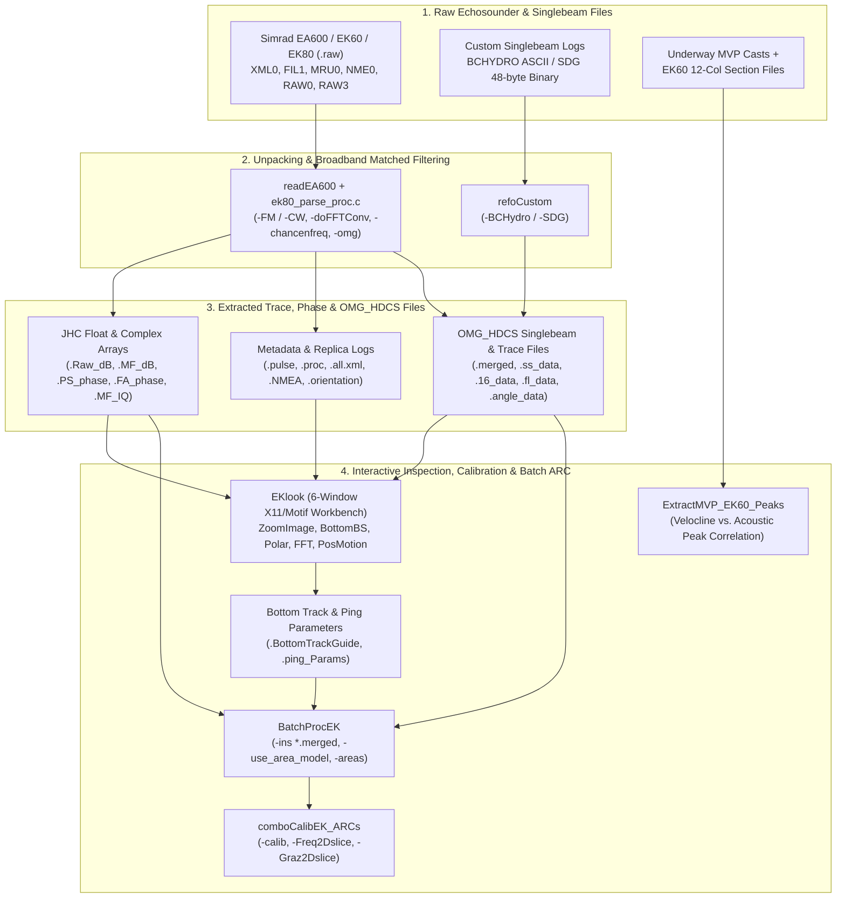

# Simrad EA600 / EK60 / EK80 Broadband Echosounder & Singlebeam Workflow

The Ocean Mapping Group (OMG) codebase includes a specialized acoustic processing suite for **Kongsberg Simrad EA600, EK60, and EK80** scientific split-beam echosounders (`code/knudsen/readEA600.c`, `code/subr/ek80_parse_proc.c`, `code/EKlook/`, and `code/grid/ExtractMVP_EK60_Peaks.c`), alongside custom hydrographic singlebeam converters (`code/singlebeam/refoCustom.c`).

Originally built for EA600 hydrographic singlebeam echosounders and EK60 narrowband CW water-column studies, the pipeline was expanded to full **broadband FM chirp pulse compression (matched filtering)**, **4-quadrant split-beam phase interferometry**, **sub-banded Fast Fourier Transform (FFT) spectral analysis**, and **broadband Angular Response Curve (ARC)** extraction for seafloor backscatter calibration using tilted or hull-mounted EK80 transducers.

---

## End-to-End Processing Architecture



---

## Stage 1: Raw Datagram Parsing & Broadband Matched Filtering (`readEA600`)

The program `readEA600` (`code/knudsen/readEA600.c`, backed by `code/subr/ek80_parse_proc.c` and `ek80_parse_proc.h`) unpacks Simrad `.raw` files across three generations of Kongsberg scientific and hydrographic sounders:
* **EA600 & EK60**: Parses `CON0` / `CON1` configuration headers and `RAW0` power/angle sample datagrams.
* **EK80 Broadband & CW**: Uses `libxml2` to parse `XML0` (`Configuration`, `Environment`, `Parameter`, `InitialParameter`) datagrams, `FIL1` digital filter stage coefficients (stages 1 & 2), `MRU0` motion records (heave, roll, pitch, heading), `NME0` GPS telegrams, and `RAW3` complex IQ 4-sector (or summed) floating-point sample datagrams.
* **Kongsberg CP300 ADCP**: Supports 4-beam ADCP `.raw` files via the `-isADCP` option.

### Pulse Replica Generation & Matched Filtering (`ek80_parse_proc.c`)
When processing broadband FM (`-FM`, default) or narrowband CW (`-CW`) `RAW3` complex IQ data, `readEA600` reconstructs the ideal transmit pulse (`generate_ideal_pulse`), applies the Stage 1 and Stage 2 decimation filters from the `FIL1` datagrams (`convolve_Complex_Filter`), normalizes by the Frobenius norm (`-useFrobNorm`), and cross-correlates the complex receive channels against the filtered transmit replica (`matched_Filter_Trace` or FFT-accelerated `-doFFTConv`).

From the 4-quadrant complex matched-filtered channels, it computes:
1. **Summed Matched-Filter Power** (`.MF_dB`) and **Raw Uncompressed Power** (`.Raw_dB`).
2. **Port-Starboard (`PS_phase`) and Fore-Aft (`FA_phase`) Split-Beam Electrical Phase Angles** (in electrical degrees, scaled by `AngleSensitivity` to mechanical beam angles).
3. **Complex Matched-Filtered IQ Traces** (`.MF_IQ`, alternating real/imaginary 32-bit floats).

### Command-Line Usage (`readEA600`)

```bash
# 1. Extract and matched-filter a 70 kHz FM broadband channel from an EK80 .raw file,
#    using FFT convolution and exporting both JHC float rasters and OMG_HDCS .merged files:
readEA600 \
  -v \
  -FM \
  -doFFTConv \
  -chancenfreq 70000 \
  -maxrangem 150.0 \
  -minfl -100.0 -maxfl -10.0 \
  -omg -heave_corr \
  -in D20230615-T142005.raw \
  -out ek80_70kHz_line01

# 2. Extract Channel 1 from a narrowband EK60 or EA600 .raw file into OMG_HDCS format:
readEA600 \
  -v \
  -chan_to_extract 1 \
  -nosams 1000 \
  -min16 10 -max16 8000 \
  -omg -heave_corr \
  -in L001_EA600.raw \
  -out ea600_ch1_line01
```

### Companion Files Produced by `readEA600`

| Extension | Format | Description |
| :--- | :--- | :--- |
| `<out>.Raw_dB` | 32-bit float JHC array | Uncompressed receive power in dB (rows = pings, columns = range samples). |
| `<out>.MF_dB` | 32-bit float JHC array | Matched-filtered (pulse-compressed) power in dB. |
| `<out>.PS_phase` | 32-bit float JHC array | Split-beam Port–Starboard phase difference (electrical degrees). |
| `<out>.FA_phase` | 32-bit float JHC array | Split-beam Fore–Aft phase difference (electrical degrees). |
| `<out>.MF_IQ` | Complex float JHC array | Interleaved $(I, Q)$ matched-filtered complex samples (`2 * Retained_Trace_Count` floats/ping). |
| `<out>.pulse` | ASCII table | Reconstructed ideal transmit pulse, Stage 1 & 2 filter weights, and decimated replica. |
| `<out>.proc` | ASCII log | Per-ping processing parameters (`TransmitPower`, `PulseDuration`, `Slope`, `SampleInterval`, `FrequencyStart`, `FrequencyEnd`, `FrobNorm`). |
| `<out>.all.xml` | XML text | Concatenated `XML0` configuration, environment, and parameter blocks. |
| `<out>.NMEA` | ASCII NMEA | Extracted `$GPGGA` / `$GPRMC` navigation strings. |
| `<out>.orientation` | Binary OMG attitude | Extracted `MRU0` roll, pitch, heave, and heading records. |
| `<out>.merged` | Binary `OMG_HDCS` | Swath/singlebeam profile file (`-omg`), accompanied by `.merged.ss_data` (8-bit trace), `.merged.16_data`, `.merged.fl_data` (float dB trace), and `.merged.angle_data` (split-beam angles). |

---

## Stage 2: Interactive Inspection & Calibration Workbench (`EKlook`)

[`EKlook`](../EKlook/EKlook.html) (`code/EKlook/EKlook.c`) is an interactive X11/Motif multi-window graphical application designed to inspect the matched-filtered file family generated by `readEA600`. It loads `<prefix>.MF_dB`, `<prefix>.Raw_dB`, `<prefix>.PS_phase`, `<prefix>.FA_phase`, `<prefix>.MF_IQ`, `<prefix>.proc`, and `<prefix>.merged`.

### Launching `EKlook`

```bash
EKlook \
  -v \
  -prefix ek80_70kHz_line01 \
  -mountangle 35.0 \
  -guidedepth 85.0 \
  -sensitivity 14.5 \
  -twowaybeamwidth 7.0 \
  -backdrop multibeam_sun.8bit \
  -areas seafloor_slope_east.r4 seafloor_slope_north.r4 \
  -sphereTS WC38_1mm_sphereTS.dat
```

### The 6 Interactive Windows of `EKlook`

1. **Main Thumbnail & Power Histogram Window** ([`EKlook.c`](../EKlook/EKlook.html), [`EK_init.c`](../EKlook/EK_init.html), [`EK_event_loop.c`](../EKlook/EK_event_loop.html)):
   * Displays the full-line echogram overview and power distribution histogram.
   * Left-drag rubber-bands a zoom region; middle-click selects a specific `currenttrace` ping; mouse wheel scrolls along the survey line.
2. **ZOOM EK-Trace Window** ([`EK_ZoomImage.c`](../EKlook/EK_ZoomImage.html)):
   * Displays a high-resolution zoomed view of the selected ping window, alongside side-by-side single-ping trace profiles of uncompressed power (`.Raw_dB`), matched-filtered power (`.MF_dB`), and Fore–Aft / Port–Starboard split-beam phase angles.
   * Allows interactive editing of the bottom-track guide curve and saving `<prefix>.BottomTrackGuide` and `<prefix>.ping_Params`.
3. **BOTTOM Detect & ARC Window** ([`EK_BottomBS.c`](../EKlook/EK_BottomBS.html)):
   * Tracks the seafloor return across the beam footprint using combined amplitude drop (`dBdrop`, default 3 dB) and split-beam phase zero-crossing (`phaseOffZero`) criteria.
   * Computes instantaneous ensonified area corrections (incorporating regional seafloor slope `.r4` rasters if provided via `-areas`) and plots the live **Angular Response Curve (ARC)** ($BS$ vs. grazing/incidence angle).
4. **POLAR EK-Trace Window** ([`EK_Polar.c`](../EKlook/EK_Polar.html)):
   * Renders polar target-strength and split-beam mechanical angle plots (Fore–Aft vs. Port–Starboard) within the transducer cone, crucial for verifying calibration sphere centering during tungsten-carbide sphere calibrations.
5. **FFT EK-Trace Window** ([`EK_FFT.c`](../EKlook/EK_FFT.html), backed by [`ek_fft_funcs.c`](../EKlook/ek_fft_funcs.html)):
   * Performs windowed Fast Fourier Transforms on the complex `.MF_IQ` samples around a target or seabed return, comparing the measured broadband frequency spectrum against the theoretical transmit replica spectrum and optional calibration sphere target strength curve (`-sphereTS`).
6. **Position-Motion EK-Trace Window** ([`EK_PosMotion.c`](../EKlook/EK_PosMotion.html)):
   * Displays the vessel track and 3D ray-traced beam footprint strike points over an 8-bit multibeam backdrop image (`-backdrop`), together with time series of roll, pitch, heave, and heading.

---

## Stage 3: Batch Broadband ARC Extraction & Calibration (`BatchProcEK`, `comboCalibEK_ARCs`)

Once bottom-tracking guides (`<prefix>.BottomTrackGuide`) and processing parameters have been verified in `EKlook`, [`BatchProcEK`](../EKlook/BatchProcEK.html) and [`comboCalibEK_ARCs`](../EKlook/comboCalibEK_ARCs.html) automate the extraction and calibration of broadband Angular Response Curves across an entire survey.

### 1. Batch Processing Survey Lines (`BatchProcEK`)

[`BatchProcEK`](../EKlook/BatchProcEK.html) (`code/EKlook/BatchProcEK.c`) iterates over multiple `.merged` (and companion `.MF_dB`, `.PS_phase`, `.FA_phase`, `.MF_IQ`, `.BottomTrackGuide`) files, computing both full-bandwidth time-domain ARCs and sub-banded FFT spectral ARCs:

```bash
BatchProcEK \
  -v \
  -dBdrop 3.0 \
  -phaseOffZero 3.0 \
  -TwoWayBeamWidth 7.0 \
  -AngleSensitivity 14.5 \
  -EnvWinSize 16 \
  -trimdB 20.0 \
  -use_area_model 2 \
  -areas bay_bathy.r4 \
  -ins procEK/line*.merged \
  -outprefix bay_70kHz_batch
```

**Outputs of `BatchProcEK`**:
* `<outprefix>.ARC_fullBW`: 2D JHC floating-point array of full-bandwidth backscatter vs. incidence angle.
* `<outprefix>.ARC_3D`: 3D histogram of full-bandwidth backscatter observations per angle bin.
* `<outprefix>.ARC_FFTbins`: 2D JHC floating-point array of spectral backscatter (frequency vs. incidence angle) derived via short-window FFTs along the seabed return.
* `<outprefix>.ARC_FFT3D`: Multi-dimensional distribution of spectral ARC values.

### 2. Combining & Calibrating Spectral ARCs (`comboCalibEK_ARCs`)

[`comboCalibEK_ARCs`](../EKlook/comboCalibEK_ARCs.html) (`code/EKlook/comboCalibEK_ARCs.c`) merges multiple `.ARC_FFTbins` files (e.g., from transducers mounted at different tilt angles or across multiple lines), applies a frequency-dependent calibration curve (`-calib <file.txt.r4>`), removes bulk offset constants (`-bulkcalibtoremove 120.0`), and slices the 2D frequency–grazing matrix into 1D profiles:

```bash
comboCalibEK_ARCs \
  -v \
  -calib sphere_calib_70kHz.txt.r4 \
  -bulkcalibtoremove 120.0 \
  -extradB 0.0 \
  -Freq2Dslice 65000.0 \
  -Graz2Dslice 45.0 \
  -in bay_70kHz_tilt15.ARC_FFTbins bay_70kHz_tilt35.ARC_FFTbins \
  -out bay_70kHz_combined_ARC
```

---

## Stage 4: Water-Column Velocline & EK60 Peak Correlation (`ExtractMVP_EK60_Peaks`)

For oceanographic internal-wave and pycnocline studies where EK60 water-column backscatter sections are compared against Moving Vessel Profiler (MVP) sound-speed casts, `ExtractMVP_EK60_Peaks` (`code/grid/ExtractMVP_EK60_Peaks.c`) automates the extraction of:
1. The **velocline depth** (depth of maximum vertical sound-speed gradient $dc/dz$) from MVP cast files (`-mvp`), and
2. The **acoustic scattering layer peak depth** from 12-column EK60 section ASCII dumps (`-ek`) within a specified depth window (`-min_z`, `-max_z`):

```bash
ExtractMVP_EK60_Peaks \
  -v \
  -min_z 8.0 -max_z 35.0 \
  -mvp mvp_casts/*.calc \
  -ek ek60_sections/*.sec \
  -out pycnocline_vs_ek60_peaks.txt
```

---

## Stage 5: Custom Singlebeam Reformatting (`refoCustom`)

For legacy or agency-specific hydrographic singlebeam datasets that are not in Simrad `.raw` format, [`refoCustom`](../singlebeam/refoCustom.html) (`code/singlebeam/refoCustom.c`) converts raw singlebeam logs into standard `OMG_HDCS` `.merged` files (`toolType = SingleBeam`, `numBeams = 1`), allowing them to be gridded with `weigh_grid`, tide-corrected with `mergeTide`, and visualized in `jview` and `SwathEd`:

### 1. BC Hydro ASCII Singlebeam (`-BCHydro`)
Reads space-delimited ASCII lines (`Northing Easting Depth Time`), converts UTM Zone 10N (`merid = -125.0`) coordinates to WGS84 Latitude/Longitude via `utmgeo`, applies an optional local datum shift (`-local_datum <m>`), and writes an `OMG_HDCS` `.merged` file:

```bash
refoCustom -v -BCHydro -local_datum 2.45 bchydro_survey.txt bchydro_survey.merged
```

### 2. SDG 48-Byte Binary Singlebeam (`-SDG`)
Reads 48-byte big-endian binary SDG records containing raw/processed UTM coordinates, raw/processed depths, tidal corrections, sound-velocity corrections, draft/heave corrections, and 16-bit quality flags (`-showbits`), writing an `OMG_HDCS` `.merged` file:

```bash
refoCustom -v -SDG -showbits sdg_line01.bin sdg_line01.merged
```

---

## Tool Reference Summary

| Tool / Module | Source Path | Role in Workflow |
| :--- | :--- | :--- |
| `readEA600` | `code/knudsen/readEA600.c` | Unpacks EA600, EK60, and EK80 `.raw` files; performs broadband FM matched filtering and exports `.MF_dB`, `.PS_phase`, `.FA_phase`, `.MF_IQ`, and `.merged` |
| `ek80_parse_proc.c` | `code/subr/ek80_parse_proc.c` | Shared library for `XML0`/`FIL1`/`MRU0`/`RAW3` parsing, chirp replica generation, filter convolution, and matched filtering |
| [`EKlook`](../EKlook/EKlook.html) | `code/EKlook/EKlook.c` | Main 6-window X11/Motif interactive workbench for EK60/EK80 trace, phase, polar, FFT, and ARC analysis |
| [`EK_ZoomImage`](../EKlook/EK_ZoomImage.html) | `code/EKlook/EK_ZoomImage.c` | Zoomed echogram and single-ping trace/phase inspection widget; exports `.BottomTrackGuide` |
| [`EK_BottomBS`](../EKlook/EK_BottomBS.html) | `code/EKlook/EK_BottomBS.c` | Interactive bottom detection, ensonified area modeling, and live Angular Response Curve (ARC) widget |
| [`EK_Polar`](../EKlook/EK_Polar.html) | `code/EKlook/EK_Polar.c` | Split-beam polar target strength and phase angle plot widget (sphere calibration verification) |
| [`EK_FFT`](../EKlook/EK_FFT.html) | `code/EKlook/EK_FFT.c` | Windowed FFT spectral analysis widget for complex `.MF_IQ` traces |
| [`EK_PosMotion`](../EKlook/EK_PosMotion.html) | `code/EKlook/EK_PosMotion.c` | Plan-view map backdrop, 3D beam strike footprint, and MRU attitude time-series widget |
| [`EK_funcs`](../EKlook/EK_funcs.html) | `code/EKlook/EK_funcs.c` | Core calculation routines for beam pointing, grazing angles, ensonified area, and ARC accumulation |
| [`ek_fft_funcs`](../EKlook/ek_fft_funcs.html) | `code/EKlook/ek_fft_funcs.c` | Complex FFT, Hamming/Hann windowing, and spectral power routines for `EKlook` and `BatchProcEK` |
| [`BatchProcEK`](../EKlook/BatchProcEK.html) | `code/EKlook/BatchProcEK.c` | Automated multi-file batch processor producing `.ARC_fullBW`, `.ARC_3D`, `.ARC_FFTbins`, and `.ARC_FFT3D` |
| [`comboCalibEK_ARCs`](../EKlook/comboCalibEK_ARCs.html) | `code/EKlook/comboCalibEK_ARCs.c` | Merges and calibrates `.ARC_FFTbins` files and extracts 2D frequency or grazing angle slices |
| `ExtractMVP_EK60_Peaks` | `code/grid/ExtractMVP_EK60_Peaks.c` | Correlates MVP velocline depths with EK60 water-column scattering peaks |
| [`refoCustom`](../singlebeam/refoCustom.html) | `code/singlebeam/refoCustom.c` | Converts custom BCHYDRO ASCII and SDG binary singlebeam logs into `OMG_HDCS` `.merged` files |
