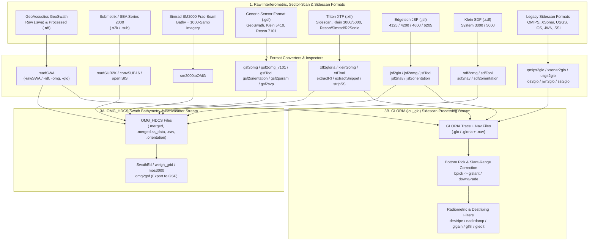

# Interferometric GeoSwath, SM2000 & Sidescan Sonar Workflows

The Ocean Mapping Group (OMG) software suite supports an extensive array of **phase-differencing (interferometric) swath sonars**, **forward-looking/profiling multibeam sonars**, and **towed or hull-mounted sidescan sonars**. These workflows bridge raw vendor formats into two primary OMG processing streams:

1. **Swath Bathymetry & Co-Registered Backscatter (`OMG_HDCS`)**: `.merged`, `.merged.ss_data`, `.nav`, and `.orientation` files ready for cleaning in `SwathEd`, gridding in `weigh_grid`, and backscatter mosaicking in `mos3000`.
2. **GLORIA Sidescan Trace Format (`jcu_glo`)**: `.glo` / `.gloria` 8-bit trace files paired with `jcu_nav` `.nav` files, processed through the `sidescan/` radiometric and geometric pipeline (`bpick`, `glslant`, `destripe`, `glgain`, `glfill`, `gledit`).

---

## Architecture & Format Conversion Matrix



---

## 1. Interferometric Swath Sonars: GeoSwath & Submetrix 2000 (`sub2k/`)

### GeoAcoustics GeoSwath Plus (`readSWA`)
`readSWA` (`code/sub2k/readSWA.c`) processes both **raw phase-differencing GeoSwath files (`.swa`)** via `-rawSWA` and **GeoSwath post-processed `.rdf` files**.
* In `-rawSWA` mode, `readSWA` reads the raw multi-stave phase and amplitude samples, applies user-defined stave spacing, mount tilt (`-tilt`, default $30^\circ$), sound speed (`-vel`), and amplitude/snr thresholds (`-minamp`, `-minsnr`), bins across-track soundings (`-bin <m>`), and outputs `OMG_HDCS` `.merged` bathymetry and `.glo` sidescan traces.
* In `.rdf` mode, it converts pre-binned GeoSwath soundings and sidescan into `.merged` (`-omg`) and/or `.glo` (`-glo`), with optional external GGA navigation (`-GGAfile`) or attitude (`-attfile`) overrides.

```bash
# Convert a raw GeoSwath .swa file into OMG_HDCS (.merged) and GLORIA (.glo) formats,
# binning interferometric soundings into 0.5 m across-track bins:
readSWA \
  -v \
  -rawSWA \
  -omg -glo \
  -tilt 30.0 -vel 1495.0 \
  -bin 0.5 -minamp 50 \
  -in line01.swa \
  -out geoswath_line01
```

### Submetrix / SEA Systems 2000 Interferometric Sonar (`readSUB2K`, `convSUB16`, `openISIS`)
* `readSUB2K` (`code/sub2k/readSUB2K.c`, backed by `code/subr/j_SUB2K.c`): Converts Submetrix 2000 `.s2k` files into `OMG_HDCS` `.merged` (and `.merged.ss_data`), `.nav`, and `.orientation` files, supporting stave angle calibration tables and raw vs. gridded beam binning (`-bin`).
* `convSUB16` (`code/sub2k/convSUB16.c`): Compresses 16-bit Submetrix backscatter traces into 8-bit `.ss_data` with linear or logarithmic scaling (`-log`, `-min16`, `-max16`).
* `openISIS` (`code/sub2k/openISIS.c`): Unpacks Submetrix data logged inside Triton ISIS containers.

```bash
readSUB2K -v -omg -bin 1.0 -in survey01.s2k -out sub2k_line01
```

---

## 2. Simrad SM2000 Multibeam & Imaging Sonar (`sm2000toOMG`)

`sm2000toOMG` (`code/grid/sm2000toOMG.c`) ingests raw **Kongsberg Simrad SM2000** fractional-beam bathymetry files alongside external 1000-sample water-column/backscatter imagery files (`-im <imagery_file>`) and `jcu_nav` navigation (`-nav <navfile>`), synthesizing a complete `OMG_HDCS` `.merged` and `.merged.ss_data` dataset:

```bash
sm2000toOMG \
  -v \
  -in sm2000_bathy.dat \
  -im sm2000_imagery.dat \
  -nav rov_track.nav \
  -out sm2000_rov_line01
```

---

## 3. Generic Sensor Format (`gsf/`) — GeoSwath, Klein 5410 & Reson 7101

The `code/gsf/` directory provides full bidirectional support for SAIC/Leidos **Generic Sensor Format (GSF)** files (up to GSF v03.06 via `code/gsf/jhc/gsf.h`), which is the standard interchange format for processed GeoSwath interferometric lines, Klein 5410 bathymetric sidescan, and Reson SeaBat 7101/8101 surveys.

| Tool | Source Path | Function & Key Options |
| :--- | :--- | :--- |
| `gsfTool` | `code/gsf/gsfTool.c` | Scans `.gsf` files, reports record counts (`SUMMARY`, `SWATH_BATHYMETRY_PING`, `SVP`, `PROCESSING_PARAMETERS`), and validates ping headers (`-v -in <file.gsf>`). |
| `gsf2omg` | `code/gsf/gsf2omg.c` | Primary converter from `.gsf` to `OMG_HDCS` `.merged`, `.merged.ss_data`, `.nav`, and `.orientation`. Supports high-density interferometric swaths (e.g., GeoSwath >254 beams) via **beam decimation (`-dec <N>`)** or **across-track spatial binning (`-bin <N>`)**, plus `-flip_roll`, `-flip_pitch`, `-flip_heave`, and `-force_1500`. |
| `gsf2omg_7101` | `code/gsf/gsf2omg_7101.c` | Specialized GSF converter tuned for Reson SeaBat 7101 imagery and snippet structures. |
| `gsf2orientation` | `code/gsf/gsf2orientation.c` | Extracts high-rate attitude packets from `.gsf` into an OMG `.orientation` file (`-in <file.gsf> -out <file.orientation>`). |
| `gsf2param` | `code/gsf/gsf2param.c` | Dumps GSF lever-arm offsets, draft, and sonar installation parameters (`-in <file.gsf>`). |
| `gsf2svp` | `code/gsf/gsf2svp.c` | Extracts embedded Sound Velocity Profiles from `.gsf` into ASCII `.svp` files (`-in <file.gsf> -out <prefix>`). |
| `omg2gsf` | `code/gsf/omg2gsf.c` | Exports cleaned `OMG_HDCS` `.merged` files back to standard `.gsf` format (`-in <file.merged> -out <file.gsf>`). |

### Example: Converting a High-Density GeoSwath GSF File to OMG_HDCS

```bash
# 1. Inspect the GSF file contents and sensor type:
gsfTool -v -in geoswath_line04.gsf

# 2. Extract embedded SVP casts and installation parameters:
gsf2svp -in geoswath_line04.gsf -out geoswath_line04
gsf2param -in geoswath_line04.gsf

# 3. Convert to OMG_HDCS (.merged + .nav + .orientation), binning every 4 interferometric soundings:
gsf2omg -v -bin 4 -in geoswath_line04.gsf -out geoswath_line04
```

---

## 4. Triton XTF (`xtf/`), Edgetech JSF (`jsf/`) & Klein SDF (`sdf/`) Workflows

### Triton Extended Format (`code/xtf/`)
XTF containers can hold pure 2-channel/4-channel sidescan (`XTFPINGHEADER`), Klein 3000/5000 sidescan+bathymetry, or encapsulated multibeam packets (Reson, R2Sonic, Simrad, Elac).

```bash
# 1. Inspect packet types, channel counts, and sample formats inside an XTF file:
xtfTool -v -in survey_line01.xtf

# 2. Extract navigation (.nav), attitude (.orientation), and header parameters:
xtf2nav -in survey_line01.xtf -out survey_line01.nav
xtf2orientation -in survey_line01.xtf -out survey_line01.orientation
xtf2param -in survey_line01.xtf

# 3A. For standard XTF sidescan: convert to GLORIA (.glo) + (.nav) (selecting HF or LF channels):
xtf2gloria -v -hf -log -min16 10 -max16 12000 -in survey_line01.xtf -out survey_line01_hf.glo

# 3B. For Klein 3000 / 5000 XTF files: convert to OMG_HDCS (.merged + .merged.ss_data):
klein2omg -v -hf -log -in klein5000_line01.xtf -out klein5000_line01

# 3C. For Reson / R2Sonic / Simrad / Elac multibeam logged in XTF:
xtf2omg_reson -v -in reson_line01.xtf -out reson_line01
xtf2omg_r2sonic -v -in r2sonic_line01.xtf -out r2sonic_line01
xtf2omg_simrad -v -in simrad_line01.xtf -out simrad_line01
elac2omg -v -in elac_line01.xtf -out elac_line01
```

Additional `xtf/` utilities include `extractRI` and `extractSnippet` (for Reson raw imagery/snippets embedded in XTF), `stripSS` (for stripping sidescan channels), and `getTVG` (for extracting time-varying gain curves).

### Edgetech JSF Format (`code/jsf/`)
Edgetech 4125, 4200, 4600, and 6205 combined sidescan /bathymetric / sub-bottom systems log in `.jsf` format:
* `jsfTool`: Inspects message IDs (Message 80 acoustic trace data, Message 3002 bathymetric swath data, NMEA, attitude) (`jsfTool -v -in line01.jsf`).
* `jsf2glo`: Extracts dual-frequency sidescan channels into GLORIA `.glo` and `.nav` files (`jsf2glo -v -hf -log -in line01.jsf -out line01_hf`).
* `jsf2omg`: Converts Edgetech 4600/6205 interferometric swath bathymetry and co-registered sidescan into `OMG_HDCS` `.merged`, `.merged.ss_data`, `.nav`, and `.orientation` (`jsf2omg -v -in line01.jsf -out line01`).
* `jsf2nav` & `jsf2orientation`: Standalone navigation and attitude extractors.

### Klein Native SDF Format (`code/sdf/`)
For Klein System 3000 and 5000 native `.sdf` files:
* `sdfTool`: Inspects SDF page versions and channel configurations (`sdfTool -v -in line01.sdf`).
* `sdf2omg`: Converts Klein `.sdf` traces, altimeter bottom picks, and attitude into `OMG_HDCS` `.merged` and `.merged.ss_data` (`sdf2omg -v -hf -log -in line01.sdf -out line01`).
* `sdf2nav` & `sdf2orientation`: Extracts `.nav` and `.orientation` files from `.sdf` records.

---

## 5. Legacy Sidescan Ingestion & The GLORIA (`jcu_glo`) Processing Pipeline (`sidescan/`)

Once sidescan data is converted into the OMG GLORIA (`jcu_glo`) format—either via `xtf2gloria`, `jsf2glo`, `readSWA -glo`, `knud2glo -glo`, `upAGCDIG`, or one of the legacy converters in `code/sidescan/convert/` (`qmips2glo`, `xsonar2glo`, `usgs2glo`, `ios2glo`, `jwn2glo`, `ssi2glo`)—it can be processed through the modular `code/sidescan/` pipeline before mosaicking.

### Step-by-Step GLORIA Sidescan Processing Pipeline

#### Step 1: First-Break Bottom Picking (`bpick`)
`bpick` (`code/sidescan/slant/bpick.c`) scans each port/starboard trace in a `.glo` file to detect the seabed first arrival (altitude above bottom) using a sliding confirmation window (`-window`, `-confirm`, `-thresh`) and writes the detected altitude back into the GLORIA record headers:

```bash
bpick -v -thresh 45 -window 15 -confirm 10 -minalt 2.0 -maxalt 80.0 line01.glo line01_picked.glo
```

#### Step 2: Slant-Range to Ground-Range Correction (`glslant`)
`glslant` (`code/sidescan/slant/glslant.c`) uses the towfish altitude stored in each GLORIA header (or an external depth grid) to project slant-range samples onto true horizontal ground range (`-pixel <m>`), removing the water-column gap at nadir:

```bash
glslant -v -pixel 0.25 line01_picked.glo line01_sr.glo
```

#### Step 3: Radiometric Balancing, Destriping & Nadir Damping (`destripe/`, `gain/`, `hist/`)
To remove ping-to-ping dropouts, across-track beam-pattern shading, and nadir saturation:
* `destripe` (`code/sidescan/destripe/destripe.c`) & `gldropStripes` (`code/sidescan/destripe/gldropStripes.c`): Suppresses along-track ping-to-ping striping artifacts.
* `nadirdamp` (`code/sidescan/destripe/nadirdamp.c`): Damps high-amplitude specular returns near the nadir track.
* `glgain` (`code/sidescan/gain/glgain.c`): Applies empirical across-track angle-varying / grazing-angle gain normalization.
* `glhist` & `glfill` (`code/sidescan/hist/glhist.c`, `glfill.c`): Computes trace intensity histograms and interpolates across missing/dropped scanlines.
* `glboxfilt` & `glsmudge` (`code/sidescan/destripe/`): Applies 2D boxcar smoothing or cosmetic feathering.
* `gledit` (`code/sidescan/edit/gledit.c`): Interactive X11 trace and altitude editor for `.glo` files.

```bash
# Suppress ping dropouts, damp specular nadir artifacts, and normalize across-track gain:
destripe line01_sr.glo line01_destriped.glo
nadirdamp line01_destriped.glo line01_damped.glo
glgain -v line01_damped.glo line01_final.glo
```
