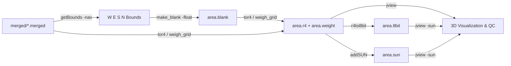
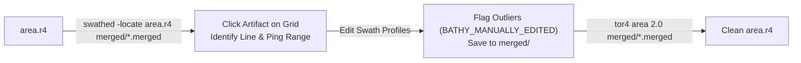
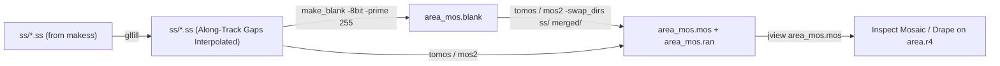

# Bathymetric Gridding, Swath Editing & Sidescan Mosaicking

Once raw Kongsberg files have been unravelled into `merged/*.merged` and `ss/*.ss`, the next phase of processing is building regional **bathymetric grids (`.r4`)**, performing **interactive swath editing (`swathed`)** to clean acoustic outliers, and constructing **sidescan/backscatter mosaics (`.mos`)**.

---

## Workflow 1: Bathymetric Gridding & Sun-Illuminated Visualization



### Step 1: Determine Geographic Survey Bounds (`getBounds`)

Scan your unravelled `.merged` files (using `-nav` for a fast navigation-header scan, or omitting `-nav` to inspect full outer-beam extents) to determine the bounding box (`West East South North` in decimal degrees):

```bash
getBounds -nav merged/*.merged
```

### Step 2: Create a Floating-Point Blank Grid Header (`make_blank`)

Use [`make_blank`](../grid/make_blank.html) with `-float` to initialize the 1024-byte `OMG1` grid template (`area.blank`).

> [!WARNING]
> **Critical Flag Ordering for `make_blank`:**  
> Always place `-float` (and `-mercator` if desired) **before** `-boundsof` or `-bounds`. Moreover, when using `-boundsof`, the output filename and `-Dx`/`-Dy` flags **must precede** `-boundsof`, because `-boundsof` consumes all remaining arguments on the command line as input files!

**Option A — Explicit geographic bounds (Recommended):**

```bash
# Format: make_blank <out_prefix> -float -bounds <West> <East> <South> <North> -Dx <res_m> -Dy <res_m>
make_blank area -float -bounds -66.55 -66.40 44.95 45.10 -Dx 5.0 -Dy 5.0
```

**Option B — Automatic bounds from `.merged` files:**

```bash
make_blank area -float -Dx 5.0 -Dy 5.0 -boundsof -nav merged/*.merged
```

### Step 3: Populate and Extract the Bathymetric Grid (`tor4` / `weigh_grid`)

The helper script [`tor4`](../scripts/tor4.html) wraps [`weigh_grid`](../grid/weigh_grid.html) to accumulate distance-weighted soundings into `area.weight` and extract the normalized 32-bit float depth raster `area.r4`:

```bash
# Standard gridding with 2x pixel footprint smoothing (-smf 2.0):
tor4 area 2.0 merged/*.merged
```

Or run `weigh_grid` directly when you need explicit beam/grazing angle gates or tidal datum shifts:

```bash
cp area.blank area.r4
weigh_grid -in area.r4 -weight area.weight -smf 2.0 -grazing 10.0 -files merged/*.merged
weigh_grid -in area.r4 -weight area.weight -extract
```

### Step 4: Generate 8-Bit Greyscale and Sun-Illuminated Hillshade Images

Convert the floating-point `.r4` grid into an 8-bit greyscale image ([`r4to8bit`](../grid/r4to8bit.html)) and a directional sun-illuminated hillshade ([`addSUN`](../grid/addSUN.html)):

```bash
# Map depths between 20m and 300m to 8-bit greyscale (area.8bit):
r4to8bit -in area.r4 -range 20.0 300.0

# Compute sun-illuminated relief (area.sun) with azimuth 315 (NW), elevation 35 deg, 4x vertical exaggeration:
addSUN area.r4 area.sun 315 35 4
```

---

## Workflow 2: Interactive Swath Cleaning (`jview` + `swathed`)

When you inspect `area.r4` or `area.sun` and see spikes, flyers, or outer-beam refraction artifacts, use [`jview`](../JV/jview.html) and [`swathed`](../SE/swathed.html) together to locate the offending survey lines, edit the soundings in-place inside `merged/*.merged`, and re-grid.



### Step 1: Inspect the Grid in `jview`

```bash
# View 3D surface with sun-illumination draped over bathymetry:
jview -sun area.8bit area.sun area.r4
```

### Step 2: Launch `swathed` in Spatial Locator Mode (`-locate`)

Pass `-locate <grid.r4>` followed by all `merged/*.merged` files to [`swathed`](../SE/swathed.html):

```bash
swathed -locate area.r4 merged/*.merged
```

1. In the locator window displaying `area.r4`, click and drag across the bathymetric spike or artifact.
2. `swathed` identifies which `.merged` line(s) pass through that geographic box and opens the 6-panel swath editor directly at those pings.
3. Lasso outlier beams to toggle their `OMG_HDCS` status flags (`BATHY_MANUALLY_EDITED`).
4. Save changes (`S` / Write) — modifications are written directly in-place to the `.merged` file.

### Step 3: Re-Run `tor4` to Update the Cleaned Grid

Because `weigh_grid` skips beams with non-zero status flags (unless `-ignore` is passed), re-running `tor4` produces a clean grid without re-unraveling the raw data:

```bash
tor4 area 2.0 merged/*.merged
```

---

## Workflow 3: Sidescan & Backscatter Mosaicking (`glfill` $\rightarrow$ `tomos` / `mos2`)



### Step 1: Interpolate Along-Track Gaps in `.ss` Files (`glfill`)

Before mosaicking, run [`glfill`](../sidescan/hist/glfill.html) on each `.ss` file to fill small along-track ping dropouts:

```bash
for ssfile in ss/*.ss; do
    glfill "$ssfile"
done
```

*(Optional)* If an older sidescan dataset needs across-track geometric/grazing-angle normalization, run [`stretchacres`](../image/stretchacres.html) before `glfill`.

### Step 2: Create an 8-Bit Blank Mosaic Template (`make_blank -8bit -prime 255`)

Unlike bathymetric grids (which use `-float`), sidescan mosaics (`mos2`) require an **8-bit** blank raster initialized to `255` (white / no-data background):

```bash
# Create an 8-bit blank mosaic header at 1.0 m resolution:
make_blank area_mos -8bit -prime 255 -bounds -66.55 -66.40 44.95 45.10 -Dx 1.0 -Dy 1.0
```

> [!TIP]
> You can usually grid sidescan backscatter at **2x to 5x finer spatial resolution** (`-Dx` / `-Dy`) than the bathymetric `.r4` grid because each beam contains many high-resolution snippet samples.

### Step 3: Build the Sidescan Mosaic (`tomos` / `mos2`)

Because `.ss` files reside in `ss/` while their companion `.merged` and `.nav` files reside in `merged/`, you must either use `-swap_dirs ss/ merged/` in [`mos2`](../newmos/mos2.html) or update [`tomos`](../scripts/tomos.html) to pass `-swap_dirs`:

```bash
# Initialize .mos and .ran from the 8-bit blank header:
cp area_mos.blank area_mos.mos
cp area_mos.blank area_mos.ran

# Run mos2 across all .ss files, resolving companion .merged/.nav files from merged/:
mos2 -in area_mos.mos -ran area_mos.ran -smf 1.5 -weight_by_dist -swap_dirs ss/ merged/ -files ss/*.ss
```

### Step 4: Drape Backscatter Mosaic over 3D Bathymetry in `jview`

If you create `area_mos.mos` using the exact same bounds and grid dimensions (`xdim`, `ydim`) as `area.r4`, you can drape the backscatter mosaic directly over the 3D bathymetric surface in `jview`:

```bash
jview -sun area_mos.mos area.sun area.r4
```
