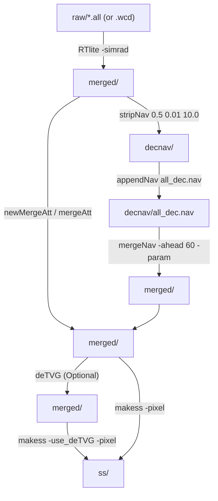

# Kongsberg `.all` & `.wcd` Legacy Unraveling Workflow

Kongsberg Maritime multibeam systems running SIS 3.x and 4.x—including **EM120**, **EM122**, **EM300**, **EM302**, **EM710**, **EM1002**, **EM3000**, **EM3002**, and older **EM2040** installations—record data in the binary `.all` (bathymetry, snippets, attitude, navigation, SVP) and `.wcd` (water column) datagram format.

In the OMG software suite, `.all` and `.wcd` files are unpacked using **[`RTlite`](../RTLite/RTlite.html)**, orchestrated via the **[`bunravel`](../scripts/bunravel.html)** bash script (`code/jonnyb/scripts/bunravel`).

---

## End-to-End `.all` Processing Pipeline



---

## Key Differences Between `.all` (`RTlite`) and `.kmall` (`read_kmall`)

| Feature | `.all` / `.wcd` (`RTlite`) | `.kmall` / `.kmwcd` (`read_kmall`) |
| :--- | :--- | :--- |
| **Input Flag** | `RTlite -d merged/<line> -simrad raw/<line>.all` | `read_kmall -d merged/<line> -kmall raw/<line>.kmall` |
| **Supported Sonars** | EM120, EM122, EM300, EM302, EM710, EM1002, EM2040 (`.all`), EM3000, EM3002 | EM2040/2040P/2040C, EM2042, EM712, EM304, EM124 (`.kmall`) |
| **Navigation Output** | Writes directly to `<line>.nav` (primary active sensor) | Writes `.nav_1`, `.nav_2`, `.nav_3` (must copy active sensor to `.nav`) |
| **Attitude Output** | Writes primary motion to `<line>.orientation` and network attitude to `.net_att` | Writes `.orientation_1`, `.net_att_1`, `.net_att_2` (must copy active sensor to `.orientation`) |
| **Empirical TVG Removal (`deTVG`)** | Frequently used on EM300/EM302/EM710/EM122/EM2040 `.all` snippets via `deTVG` + `makess -use_deTVG` | Rarely needed if calibrated backscatter or `-SnippetExtend` is used directly in `makess` |

---

## Option 1: Automated Unraveling with `bunravel`

The [`bunravel`](../scripts/bunravel.html) script automates directory creation (`merged/`, `decnav/`, `ss/`), unpacking via `RTlite`, navigation filtering, and sidescan generation.

### Standard Bathymetry + Backscatter (`deTVG`) Run

From the parent directory containing `raw/`:

```bash
# Unpack all raw/*.all files, run deTVG, and generate 1.0 m pixel sidescan (.ss) files:
bunravel -path raw -ext all -ss -pixel 1.0 -detvg
```

### High-Resolution Shallow-Water Survey (with Attitude Re-Merging)

For shallow-water EM2040 or EM3002 surveys where high-rate motion compensation and lever-arm corrections are critical:

```bash
# Unpack, merge lever-arm navigation, merge high-rate attitude, and build 0.25 m sidescan:
bunravel -path raw -ext all -att -ss -pixel 0.25 -detvg
```

### Handling GPS 1024-Week Rollover Bugs in Legacy `.all` Logs

If a legacy survey was logged during a GPS week rollover window and timestamps jump by ~19.7 years, pass `-rollover`:

```bash
bunravel -path raw -ext all -rollover -ss -pixel 1.0
```

---

## Option 2: Step-by-Step Manual Commands (or Custom Script)

When you need full control over sound-velocity ray-tracing (`newMergeAtt -redoref -recalc_beamVec`), delayed heave (`mergeHeave`), or water column pointers (`moveOverWCinfo`), run the individual steps directly:

```bash
mkdir -p merged decnav ss
LINE="0012_20180721_143000_Ship"

# 1. Optional: If .wcd water column file exists, unpack it first
if [ -f "raw/${LINE}.wcd" ]; then
    RTlite -d "merged/${LINE}" -simrad "raw/${LINE}.wcd"
    mv "merged/${LINE}.merged" "merged/justWC_${LINE}.merged"
fi

# 2. Unpack .all file with RTlite
RTlite -d "merged/${LINE}" -simrad "raw/${LINE}.all" -maxdepth 1000.0

# 3. Transfer water column byte offsets if .wcd was unpacked
if [ -f "merged/justWC_${LINE}.merged" ]; then
    moveOverWCinfo "merged/${LINE}.merged" "merged/justWC_${LINE}.merged"
    rm "merged/justWC_${LINE}.merged"
fi

# 4. Filter navigation and merge lever arms
stripNav "merged/${LINE}.nav" "decnav/${LINE}.nav" 0.5 0.01 10.0
appendNav decnav/all_dec.nav "decnav/${LINE}.nav"
mergeNav -ahead 60.0 -param "merged/${LINE}.param" "merged/${LINE}.merged" decnav/all_dec.nav

# 5. Recompute 3D beam vectors and ray-trace with filtered SVP
newMergeAtt -redoref -recalc_beamVec "merged/${LINE}"

# 6. Flatten Kongsberg empirical TVG crossover artifacts and create .ss file
deTVG -in "merged/${LINE}.merged"
makess -use_deTVG -pixel 1.0 "merged/${LINE}"
mv "merged/${LINE}.ss" ss/
```
