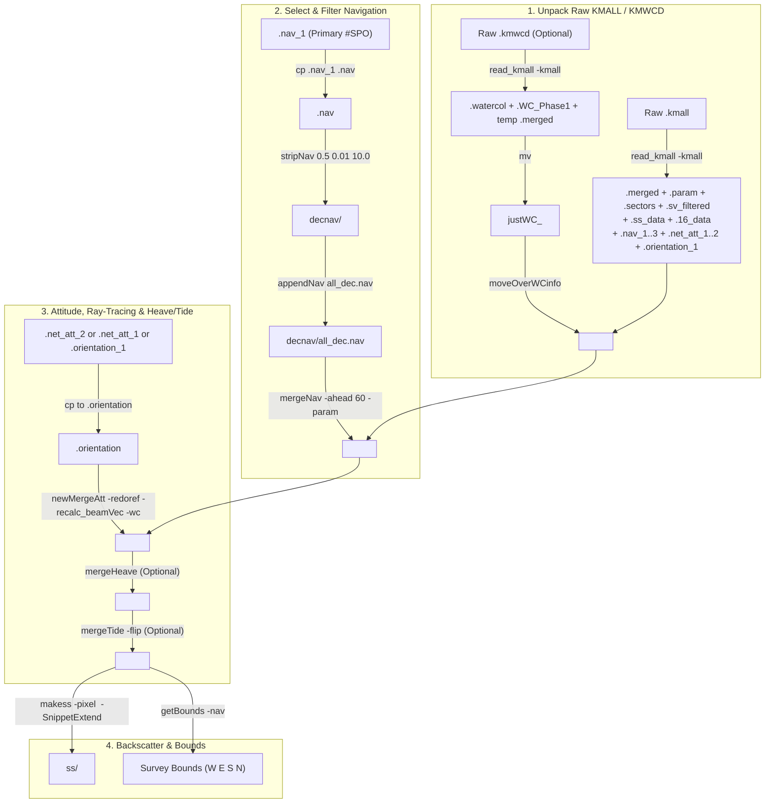

# Kongsberg `.kmall` & `.kmwcd` Unraveling Workflow

Modern Kongsberg Maritime multibeam echosounders running SIS 5.x (including **EM2040**, **EM2040P**, **EM2040C**, **EM2042**, **EM712**, **EM304**, and **EM124**) log bathymetry, seabed imagery (snippets), navigation, attitude, and sound velocity casts in `.kmall` files, and optionally log water column data in companion `.kmwcd` files.

This guide documents the complete step-by-step OMG unraveling pipeline, explaining **why** each step occurs in its specific order and how to customize the workflow for different sonar models, water depths, and sensor configurations.

---

## End-to-End Pipeline Architecture



---

## Critical Rules for `.kmall` Processing

> [!IMPORTANT]
> **Rule 1: Always unravel `.kmwcd` BEFORE `.kmall`.**  
> Both `.kmwcd` and `.kmall` overwrite `<line>.merged` when processed by [`read_kmall`](../kmall/read_kmall.html). When `read_kmall` unpacks a `.kmwcd` file, the resulting `.merged` file contains *only* ping timestamps and byte offsets into `.watercol` and `.WC_Phase1` (no bathymetry). You must rename that temporary `.merged` file to `justWC_<line>.merged`, run `read_kmall` on the `.kmall` file second, and then run `moveOverWCinfo <line>.merged justWC_<line>.merged` to transfer the water column byte pointers into the bathymetric `.merged` file.

> [!IMPORTANT]
> **Rule 2: Explicitly copy your active Navigation (`.nav_*`) and Attitude (`.net_att_*` / `.orientation_1`) files.**  
> Unlike legacy `.all` files, Kongsberg `.kmall` files log multiple simultaneous position (`#SPO`) and attitude (`#SKM`) streams. `read_kmall` splits these into separate files so they do not overwrite each other:
> - Position (`#SPO`): `.nav_1` (`sensorSystem=0`), `.nav_2` (`sensorSystem=1`), `.nav_3` (`sensorSystem=2`).
> - Attitude (`#SKM`): `.net_att_2` (`sensorInputFormat=1`, KM Binary), `.orientation_1` (`sensorInputFormat=2`, EM3000), `.net_att_1` (`sensorInputFormat=7`, POS M/V GRP 102/103).
> Downstream tools (`stripNav`, `mergeNav`, `newMergeAtt`, `makess`) strictly look for `<line>.nav` and `<line>.orientation`.

---

## Step-by-Step Manual Walkthrough (Single Survey Line)

Suppose you have a raw line `0001_20240615_120000_Ship.kmall` (and optional `.kmwcd`) in `raw/`.

### Step 1: Set Up Directories and Unpack Raw Files

```bash
mkdir -p merged decnav ss
LINE="0001_20240615_120000_Ship"

# 1a. Optional: If a .kmwcd water column file exists, unpack it FIRST
if [ -f "raw/${LINE}.kmwcd" ]; then
    read_kmall -d "merged/${LINE}" -kmall "raw/${LINE}.kmwcd" -maxdepth 2500.0
    mv "merged/${LINE}.merged" "merged/justWC_${LINE}.merged"
fi

# 1b. Unpack the .kmall bathymetry & snippet file
read_kmall -d "merged/${LINE}" -kmall "raw/${LINE}.kmall" -maxdepth 2500.0

# 1c. Copy water column byte pointers into the bathymetric .merged file
if [ -f "merged/justWC_${LINE}.merged" ]; then
    moveOverWCinfo "merged/${LINE}.merged" "merged/justWC_${LINE}.merged"
    rm "merged/justWC_${LINE}.merged"
fi
```

### Step 2: Select and Filter Navigation

Check which `.nav_*` file is populated and represents the primary positioning system (almost always `.nav_1`):

```bash
cp "merged/${LINE}.nav_1" "merged/${LINE}.nav"

# Filter spikes and decimate navigation (min interval 0.5s, min dist 0.01m, max speed 10 m/s)
stripNav "merged/${LINE}.nav" "decnav/${LINE}.nav" 0.5 0.01 10.0

# Append into a continuous multi-line navigation file so line ends interpolate cleanly
appendNav decnav/all_dec.nav "decnav/${LINE}.nav"

# Merge lever-arm-corrected navigation into the .merged swath file
mergeNav -ahead 60.0 -param "merged/${LINE}.param" "merged/${LINE}.merged" decnav/all_dec.nav
```

### Step 3: Select Attitude Sensor and Recompute Ray-Traced Beam Vectors

Check which attitude file (`.net_att_2`, `.net_att_1`, or `.orientation_1`) is non-empty using `ls -lh merged/${LINE}.*att* merged/${LINE}.orientation*`:

```bash
# For KM Binary network attitude (sensorInputFormat = 1):
cp "merged/${LINE}.net_att_2" "merged/${LINE}.orientation"

# Recompute beam launch vectors and ray-trace through the filtered sound velocity profile:
# (Omit -wc if no .kmwcd water column data was unpacked)
newMergeAtt -redoref -recalc_beamVec -wc "merged/${LINE}"

# Optional: Apply delayed heave if .heave is non-empty
if [ -s "merged/${LINE}.heave" ]; then
    mergeHeave "merged/${LINE}"
fi

# Optional: Apply tide correction
# mergeTide -flip -in "merged/${LINE}.merged" -tide area.tide
```

### Step 4: Generate Sidescan (`.ss`) Backscatter Line

```bash
# Generate GLORIA-format .ss file from snippets (.ss_data / .16_data)
# Adjust -pixel (across-track bin size in meters) to match water depth / sonar resolution
makess -pixel 2.0 -SnippetExtend "merged/${LINE}"
mv "merged/${LINE}.ss" ss/
```

---

## Batch & Parallel Processing Using Helper Scripts

Rather than running each step manually, use the repository helper scripts:

- **[`unravel_KMALL_single`](../scripts/unravel_KMALL_parallel.html)**: Processes a single `.kmall` / `.kmwcd` line.
- **[`unravel_KMALL_2500m_RevHplus_netatt2`](../scripts/unravel_KMALL_parallel.html)**: Loops serially over all `raw/*.kmall` files.
- **[`unravel_KMALL_2500m_RevHplus_netatt2_parallel`](../scripts/unravel_KMALL_parallel.html)**: Uses GNU `parallel` (`-j 12`) to execute the CPU-intensive unpacking (`read_kmall`), ray-tracing (`newMergeAtt`), and sidescan generation (`makess`) across all CPU cores while keeping `appendNav` sequential.

### Adapting `unravel_KMALL_2500m_RevHplus_netatt2_parallel` for Different Surveys

When adapting the parallel script for a new cruise or sonar model, inspect and adjust these four parameters:

| Parameter in Script | Default Value | How to Customize for Your Dataset |
| :--- | :--- | :--- |
| **`-maxdepth <m>`** (passed to `read_kmall`) | `2500.0` | Set slightly deeper than the maximum depth in your survey area (e.g., `-maxdepth 150.0` for coastal EM2040 surveys; `-maxdepth 6000.0` for abyssal EM124 surveys). Beams deeper than this threshold are flagged as rejected on import. |
| **Attitude File Copy** (`cp merged/$name.net_att_2 ...`) | `.net_att_2` | Run `read_kmall` on one test file and check `ls -l merged/`.<br>• If `.net_att_2` is largest $\rightarrow$ keep `cp merged/$name.net_att_2 merged/$name.orientation`<br>• If `.net_att_1` is largest (POS/MV GRP 102/103) $\rightarrow$ change to `cp merged/$name.net_att_1 merged/$name.orientation`<br>• If `.orientation_1` is largest $\rightarrow$ change to `cp merged/$name.orientation_1 merged/$name.orientation` |
| **`newMergeAtt` `-wc` flag** | `-wc` enabled | Keep `-wc` only if `.kmwcd` files are present and unpacked. If processing `.kmall` files without `.kmwcd`, remove `-wc` so `newMergeAtt` does not search for `.watercol`. |
| **`makess -pixel <m>`** | `2.0` | Set across-track sidescan pixel size based on water depth and sonar model:<br>• **EM2040 / EM2042 (< 100 m):** `-pixel 0.2` to `0.5`<br>• **EM712 (100 – 1000 m):** `-pixel 1.0` to `2.0`<br>• **EM304 / EM124 (> 1000 m):** `-pixel 2.0` to `10.0` |
