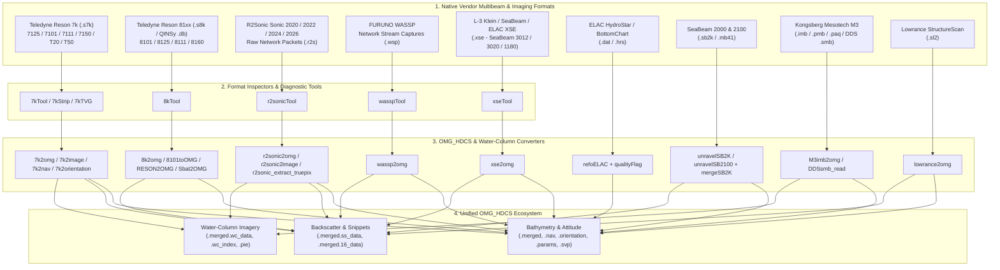

# Multi-Vendor Multibeam Sonar Converters Workflow

While Kongsberg Simrad `.all` and `.kmall` files are ingested via `unravel` and `kmall2omg` (see the [Multibeam Bathymetry Workflow](kongsberg-kmall-unraveling.html)), the Ocean Mapping Group (OMG) software suite supports a wide spectrum of hydrographic, tactical, fisheries, and forward-looking multibeam echosounders from **Teledyne Reson**, **R2Sonic**, **FURUNO WASSP**, **L-3 ELAC / SeaBeam (XSE, ELAC, SB2000/2100)**, **Kongsberg Mesotech M3**, and **Lowrance**.

Every vendor converter translates native packet streams into the unified **`OMG_HDCS`** file family (`.merged`, `.merged.ss_data`, `.merged.16_data`, `.merged.wc_data`, `.nav`, `.orientation`, `.params`, and `.svp`), enabling identical downstream processing in `SwathEd`, `weigh_grid`, `mos3000`, and `wc_look`.

---

## Multi-Vendor Ingestion Architecture



---

## 1. Teledyne Reson SeaBat 7k & 8k Series (`reson/`, `Sbat/`)

### Reson 7k Data Format (`.s7k`) — SeaBat 7125, 7101, 7111, 7150, T20, T50
The `code/reson/` suite parses the Teledyne Reson Data Frame (7k) protocol, handling standard bathymetry (`7006`), raw beam-formed magnitude/phase (`7000`, `7004`, `7027` raw detections), snippets (`7008`, `7028`), Sidescan (`7007`), water-column (`7018`, `7042`), roll/pitch/heave (`1012`, `1013`, `1016`), heading (`1013`), and position (`1003`).

#### Step 1: Inspecting `.s7k` Packet Inventories (`7kTool`)
Always run `7kTool` first to inventory which 7k record types were logged by the 7k Center / PDS2000 acquisition software:

```bash
7kTool -v -in 20230512_141022.s7k
```

#### Step 2: Converting Bathymetry, Snippets & Sidescan (`7k2omg`)
`7k2omg` (`code/reson/7k2omg.c`) converts `.s7k` files into `OMG_HDCS` `.merged`, `.merged.ss_data`, `.merged.16_data`, `.nav`, `.orientation`, and `.params`.
* **Bathymetry source selection**: Supports legacy `7006` bathymetry packets or modern **`7027` Raw Detection packets (`-use7027`)**.
* **Backscatter source selection**: Extracts snippets from `7008` or **`7028` Snippet packets (`-use7028`)** or `7007` sidescan (`-use7007`), with optional real-time TVG removal (`-removeTVG`).
* **Multi-head & Forward-Looking configurations**: Supports dual-head vessels (`-head1` / `-head2`) and tilted/forward-looking installations (`-head_tilt <deg>`).

```bash
# Convert a Reson 7125 / T50 .s7k file using 7027 detections and 7028 snippets:
7k2omg \
  -v \
  -use7027 -use7028 \
  -removeTVG \
  -in 20230512_141022.s7k \
  -out reson_line01
```

#### Step 3: Extracting Water-Column Imagery (`7k2image`) & Auxiliary Streams
* `7k2image` (`code/reson/7k2image.c`): Extracts `7018` (16-bit amplitude + phase) or `7042` compressed water-column packets into OMG `.merged.wc_data` and `.wc_index` files (for interactive viewing in `wc_look`), or renders direct polar fan (`.pie`) and vertical section images (`-pixel <m> -maxdepth <m>`).
* `7k2nav` & `7k2orientation`: Standalone extractors for `1003` position and `1012`/`1013`/`1016` attitude records.
* `7kStrip`: Strips bulky `7018` / `7042` water-column records from `.s7k` archives to create lightweight bathymetry-only `.s7k` files.
* `7kTVG`: Extracts and plots time-varying gain curves (`7010`) from `.s7k` files.

### Reson 81xx Series (`8k2omg`, `8101toOMG`, `RESON2OMG`, `Sbat2OMG`)
For Reson SeaBat 8101, 8125, 8111, 8160, and legacy 9001/9002 systems:
* `8kTool` & `8k2omg` (`code/reson/8kTool.c`, `8k2omg.c`): Inspects and converts native `.s8k` serial/network recordings into `OMG_HDCS` `.merged` and `.merged.ss_data`.
* `8101toOMG`, `RESON2OMG`, `Sbat2OMG`, and `GSF9002toOMG` (`code/Sbat/`): Convert QINSy ASCII/binary exports, Hypack Reson logs, and legacy SeaBat 9001/9002 files into `OMG_HDCS` format.

---

## 2. R2Sonic Sonic 2020 / 2022 / 2024 / 2026 (`r2sonic/`)

The `code/r2sonic/` directory handles raw UDP packet captures from R2Sonic broadband multibeam echosounders (`BTH0` bathymetry, `SNI0` snippets, `Bsc0`/`TPX0` TruePix compressed backscatter/angle, `WCD0`/`WCI0` water column, `ATT0` attitude, `POS0` position).

```bash
# 1. Inspect packet headers and frequency/mode changes in a raw R2Sonic file:
r2sonicTool -v -in line01.r2s

# 2. Convert R2Sonic bathymetry (BTH0) and snippets (SNI0) or TruePix (TPX0) to OMG_HDCS:
r2sonic2omg \
  -v \
  -do_truepix \
  -in line01.r2s \
  -out r2s_line01

# 3. Extract R2Sonic water-column packets into OMG .wc_data format or fan images:
r2sonic2image \
  -v \
  -write_out_WC \
  -in line01.r2s \
  -omg r2s_line01

# 4. Standalone TruePix amplitude + phase extractor:
r2sonic_extract_truepix -v -in line01.r2s -out r2s_line01_tp
```

---

## 3. FURUNO WASSP Multibeam (`wassp/`)

For FURUNO WASSP fishery and hydrographic multibeam systems (`code/wassp/`):
* `wasspTool`: Inspects WASSP raw packet types (`CORBATHY`, `RAWBATHY`, `SONAR`, `WCD`, `NAVDAT`) (`wasspTool -v -in survey01.wsp`).
* `wassp2omg`: Converts WASSP bathymetry, backscatter imagery, navigation, and attitude into `OMG_HDCS` `.merged`, `.merged.ss_data`, `.nav`, and `.orientation`:

  ```bash
  wassp2omg -v -in survey01.wsp -out wassp_line01
  ```

---

## 4. L-3 / SeaBeam / ELAC Multibeam Formats (`xse/`, `elac/`, `sb2k/`)

### XSE Format — SeaBeam 3012 / 3020 / 1180 & ELAC (`xse/`)
The extensible **XSE** frame format (`Ship`, `Nav`, `Attitude`, `MultiBeam`, `SideScan`, `SVP` frames) is processed using `xseTool` and `xse2omg` (`code/xse/`):

```bash
# Inspect XSE frame IDs and group counts:
xseTool -v -in line01.xse

# Convert XSE multibeam bathymetry, sidescan, navigation, and attitude to OMG_HDCS:
xse2omg -v -in line01.xse -out seabeam_line01
```

### ELAC BottomChart / HydroStar (`elac/`)
* `refoELAC` (`code/elac/refoELAC.c`): Unpacks native ELAC telegrams (`Telegram 10` attitude, `11` position, `12` parameters, `18` bathymetry, `19` sidescan) into `OMG_HDCS` `.merged`, `.nav`, and `.orientation`.
* `qualityFlag` (`code/elac/qualityFlag.c`): Filters or resets ELAC beam quality flags in `.merged` files based on amplitude, pulse length, or colinearity criteria.

### SeaBeam 2000 & SeaBeam 2100 (`sb2k/`)
SeaBeam 2000 (`.sb2k`) and SeaBeam 2100 (`.mb41` / `.sb2100`) processing is a two-stage pipeline:
1. **Unpack Raw Telegrams**: Run `unravelSB2K` (for SeaBeam 2000) or `unravelSB2100` (for SeaBeam 2100) to split raw vendor archives into intermediate bathymetry, `.nav`, `.orientation`, and sidescan files.
2. **Merge Navigation & Raytrace**: Run `mergeSB2K` to interpolate navigation and attitude onto ping times and write the final `OMG_HDCS` `.merged` and `.merged.ss_data` files:

```bash
unravelSB2100 -v -in raw_line01.mb41 -out sb2100_line01
mergeSB2K -v -in sb2100_line01 -nav sb2100_line01.nav -out sb2100_line01.merged
```

---

## 5. Kongsberg Mesotech M3 Imaging & Profiling Multibeam (`M3/`)

The Kongsberg Mesotech **M3** dual-mode imaging and profiling sonar produces beamformed `.imb` (Imaging Mode), `.pmb` (Profiling Mode Bathymetry), and `.paq` (Phase + Amplitude Quality) files (`code/M3/`).

### `M3imb2omg` (`code/M3/M3imb2omg.c`)
`M3imb2omg` supports two distinct operational modes:
1. **IMB Image Stabilization & Fan Projection**: Stabilizes raw `.imb` imaging pings for roll, pitch, or heading (`-roll_compensate`, `-pitch_compensate`, `-heading_compensate`, `-use_external_motion`) and renders polar wedge (`.pie`) or cartesian water-column images (`-pixel 0.25 -mindepth 0 -maxdepth 100`).
2. **PMB / PAQ Conversion to OMG_HDCS & Water-Column**: Converts `.pmb`/`.paq` profiling datasets into `OMG_HDCS` `.merged` bathymetry, snippets (`-do_snippet`), and `.merged.wc_data` water-column files (`-write_to_OMG -write_out_WC`), with optional water-column trimming (`-trim_WC_by_Depth` or `-trim_WC_by_range`, `-head_tilt`, `-head_depth`) and missing-beam re-tracking (`-reTrack`):

```bash
# Convert Mesotech M3 profiling (.pmb/.paq) data into OMG_HDCS (.merged + .wc_data)
# with a -45 deg tilted head at 1.0 m draft and automatic beam re-tracking:
M3imb2omg \
  -v \
  -write_to_OMG -do_snippet -write_out_WC \
  -reTrack -trim_WC -trim_WC_by_Depth \
  -head_tilt -45.0 -head_depth 1.0 \
  -min_allowed_depth 2.0 -max_allowed_depth 40.0 \
  -M3imb survey_m3.pmb \
  -omg m3_line01
```

For Defence R&D Canada (DRDC) DDS `.smb` sonar files, `DDSsmb_read` (`code/M3/DDSsmb_read.c`) provides an equivalent converter into `OMG_HDCS` `.merged` and `.wc_data`.

---

## 6. Lowrance Recreational / StructureScan Sonar (`james/lowrance2omg`)

`lowrance2omg` (`code/james/lowrance2omg.c`) unpacks recreational **Lowrance `.sl2`** StructureScan / DownScan / Primary singlebeam+sidescan logs, extracting the primary 200 kHz / 83 kHz vertical sounder depth and StructureScan port/starboard imagery into `OMG_HDCS` `.merged`, `.merged.ss_data`, and `.nav` files:

```bash
lowrance2omg -v -in Sonoma_Lake_01.sl2 -out lowrance_line01
```

---

## Summary Comparison of Multi-Vendor Converters

| Sonar Family | Raw Extension | Inspector Tool | Primary Converter | Water-Column Converter | Output Formats |
| :--- | :--- | :--- | :--- | :--- | :--- |
| **Teledyne Reson 7k** (7125, T20, T50, 7150) | `.s7k` | `7kTool` | `7k2omg` | `7k2image` | `.merged`, `.ss_data`, `.16_data`, `.wc_data`, `.nav`, `.orientation` |
| **Teledyne Reson 8k** (8101, 8125, 8111) | `.s8k`, `.db` | `8kTool` | `8k2omg`, `8101toOMG`, `RESON2OMG` | — | `.merged`, `.ss_data`, `.nav`, `.orientation` |
| **R2Sonic** (2020, 2022, 2024, 2026) | `.r2s` | `r2sonicTool` | `r2sonic2omg` | `r2sonic2image` | `.merged`, `.ss_data`, `.16_data`, `.wc_data`, `.nav`, `.orientation` |
| **FURUNO WASSP** | `.wsp` | `wasspTool` | `wassp2omg` | — | `.merged`, `.ss_data`, `.nav`, `.orientation` |
| **L-3 / SeaBeam XSE** (3012, 3020, 1180) | `.xse` | `xseTool` | `xse2omg` | — | `.merged`, `.ss_data`, `.nav`, `.orientation`, `.svp` |
| **ELAC HydroStar** | `.dat`, `.hrs` | — | `refoELAC` (`qualityFlag`) | — | `.merged`, `.ss_data`, `.nav`, `.orientation` |
| **SeaBeam 2000 / 2100** | `.sb2k`, `.mb41` | — | `unravelSB2K` / `unravelSB2100` + `mergeSB2K` | — | `.merged`, `.ss_data`, `.nav`, `.orientation` |
| **Kongsberg Mesotech M3** | `.imb`, `.pmb`, `.paq` | — | `M3imb2omg` | `M3imb2omg -write_out_WC` | `.merged`, `.ss_data`, `.wc_data`, `.pie`, `.nav`, `.orientation` |
| **Lowrance StructureScan** | `.sl2` | — | `lowrance2omg` | — | `.merged`, `.ss_data`, `.nav` |
