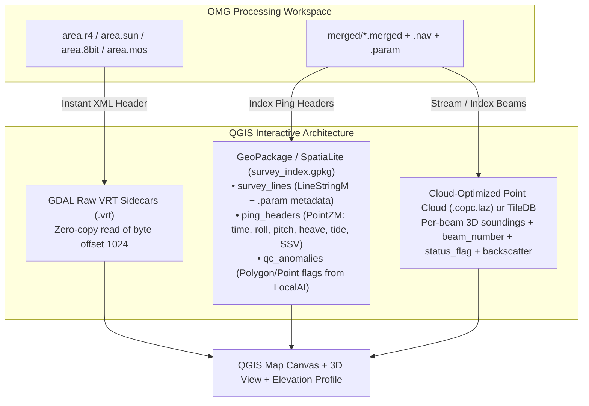

# QGIS Plugin & GIS Integration Architecture

This guide documents both the **existing GIS export utilities** in the OMG codebase (`r4toESRI`, `r4toASCII`, `dumpXYZ`) and the **binary header specifications and recommended architecture** for building a future **QGIS Plugin + LocalAI Assistant** capable of visualizing and analyzing `.r4`, `.sun`, `.8bit`, `.mos`, `.merged`, and `.kmall` data at every stage of processing.

---

## 1. Existing GIS Export Tools in the OMG Codebase

Before building custom readers, note that the codebase already contains two fast C utilities that bridge OMG formats to GIS formats:

### Exporting Grids & Mosaics to ESRI `.bil`/`.hdr`/`.prj` or `.asc` (`r4toESRI`)
Located in `code/grid/r4toESRI.c`, `r4toESRI` converts any `JHC_header` (`OMG1`) raster (`.r4`, `.8bit`, `.sun`, `.mos`) into an ESRI Band Interleaved by Line (`.bil` + `.hdr` + `.prj`) or ASCII grid (`.asc`) that QGIS (GDAL) can open natively:

```bash
# Export a 32-bit float bathymetric grid (.r4) with a .prj file for direct loading in QGIS:
r4toESRI -PRJ -CHS -in area.r4 -out area_esri

# Export an 8-bit sun-illuminated (.sun) or sidescan mosaic (.mos) raster:
r4toESRI -PRJ -CHS -in area.sun -out area_sun_esri
```

### Exporting Soundings & Navigation from `.merged` (`dumpXYZ`)
Located in `code/omg/dumpXYZ.c`, `dumpXYZ` extracts geo-referenced beam soundings (`Lon Lat Depth [Reflectivity]`) or ping navigation/attitude time-series (`-att`) from `.merged` files:

```bash
# Export valid soundings (skipping flagged outliers) as Lon, Lat, Tide-Corrected Depth:
dumpXYZ -tidecor -out line1_soundings.xyz merged/0001_line.merged

# Export vessel trackline, attitude (roll, pitch, gyro, heave), and nadir depth every 5 seconds:
dumpXYZ -att -timeinterval 5.0 -out line1_track.txt merged/0001_line.merged
```

---

## 2. Direct Binary Parsing in Python / QGIS (Zero-Copy `JHC_header`)

For a QGIS plugin, converting `.r4`, `.sun`, `.8bit`, and `.mos` files via intermediate disk copies is unnecessary. Every OMG raster file consists of a fixed **1024-byte header (`JHC_header` in `code/subr/array.h`)** followed immediately by a flat row-major binary array (`dx * dy` pixels).

A Python QGIS plugin can read `.r4`, `.sun`, `.8bit`, and `.mos` files **directly via `numpy.memmap` or a custom GDAL VRT wrapper** in milliseconds without duplicating data on disk.

### `JHC_header` Binary Layout (`code/subr/array.h`, 1024 bytes, Little-Endian on x86_64)

| Byte Offset | C Type | Python `struct` | Field Name | Description |
| :---: | :--- | :---: | :--- | :--- |
| `0..3` | `char[4]` | `4s` | `header_name` | Magic string `"OMG1"` |
| `4..7` | `int32` | `<i` | `dx` | Number of columns (width in pixels) |
| `8..11` | `int32` | `<i` | `dy` | Number of rows (height in pixels) |
| `12..15` | *padding* | `4x` | *(alignment)* | 4-byte struct alignment before `double` on 64-bit/32-bit compilers |
| `16..23` | `double` | `<d` | `xmin` | Western bound (decimal degrees; negative West) |
| `24..31` | `double` | `<d` | `xmax` | Eastern bound (decimal degrees) |
| `32..39` | `double` | `<d` | `ymin` | Southern bound (decimal degrees) |
| `40..47` | `double` | `<d` | `ymax` | Northern bound (decimal degrees) |
| `48..55` | `double` | `<d` | `xstep` | East-West pixel size (meters if projected, else arc-minutes) |
| `56..63` | `double` | `<d` | `ystep` | North-South pixel size (meters if projected, else arc-minutes) |
| `64` | `uint8` | `<B` | `data_type` | `1` = 8-bit (`uint8`, `.8bit`/`.sun`/`.mos`), `2` = 16-bit, `3` = 32-bit float (`float32`, `.r4`) |
| `65` | `uint8` | `<B` | `rgb_bw` | Colour mode (`4` = greyscale) |
| `66` | `uint8` | `<B` | `projection` | `1` = Mercator, `2` = UTM (`proj_merid` = central meridian), `3` = Unprojected geographic, `10` = Lambert Conformal Conic |
| `67` | `uint8` | `<B` | `ellipsoid` | `1` = WGS84 |
| `68..71` | `float32` | `<f` | `proj_merid` | Central meridian (degrees, e.g., `-66.0` for UTM Zone 19N) |
| `72..83` | `float32[3]` | `<3f` | `sun_elev`, `sun_azi`, `sun_exag` | Sun illumination parameters |
| `84..95` | `float32[3]` | `<3f` | `view_elev`, `view_azi`, `view_exag` | 3D viewing parameters |
| `96..103` | `float32[2]` | `<2f` | `max_value`, `min_value` | Minimum and maximum grid values |
| `1024+` | `uint8[]` or `float32[]` | `numpy.memmap` | **Pixel Data** | `dx * dy` elements starting at byte offset `1024`. No-data value is `9999.0` (or `0.0`) for `float32` and `255` for `uint8`. |

> [!TIP]
> **Instant GDAL Virtual Raster (`.vrt`) Generation in QGIS:**  
> Because the pixel array starts at byte offset `1024` with a fixed line offset (`dx * bytes_per_pixel`), a QGIS plugin can generate a lightweight `<VRTDataset subClass="VRTRawRasterBand">` XML sidecar (`area.r4.vrt`) pointing to `area.r4` with `<ImageOffset>1024</ImageOffset>`. QGIS will then render `.r4`, `.sun`, `.8bit`, and `.mos` files natively with hardware-accelerated hillshading, colour ramps, and profile tools—with **zero file conversion**!

---

## 3. Recommended Architecture for Visualizing `.merged` & `.kmall` in QGIS

When designing the interactive database / visualization layer for the QGIS plugin and LocalAI assistant, separating **2D/2.5D Track & Raster Layers** from **3D Beam Point Clouds** gives the best performance:



### Why a Hybrid **GeoPackage (`.gpkg`) + GDAL Raw `.vrt` + COPC (`.copc.laz`)** Beats a Single Geodatabase

1. **Rasters (`.r4`, `.sun`, `.8bit`, `.mos`) $\rightarrow$ GDAL Raw `.vrt` Sidecars:**
   - Every time `tor4`, `weigh_grid`, `addSUN`, or `mos2` updates a grid on disk, QGIS immediately reflects the changes on canvas refresh without re-importing into a database.
2. **Survey Lines, Ping Headers, SVP Casts & `.param` Metadata $\rightarrow$ GeoPackage (`survey_index.gpkg`):**
   - A single SQLite-based **GeoPackage** stores:
     - `survey_lines`: 2D `LineStringM` tracklines (with epoch timestamps in the `M` coordinate), linked to the `.kmall` / `.merged` path, `echoSounderID`, lever arms (`Nav_X`, `Nav_Y`, `Trans1_X..Z`), and processing status (e.g., whether `mergeNav`, `newMergeAtt`, `mergeTide` have been run).
     - `ping_headers`: Ping-level time-series (`ping_no`, `timestamp`, `lat`, `lon`, `heading`, `roll`, `pitch`, `heave`, `tide`, `surface_ssv`, `watercol_offset`).
     - `sv_profiles`: Unpacked `.sv_filtered` casts linked by timestamp and location.
   - Because GeoPackage is a standard SQLite database, the **LocalAI assistant** can execute SQL queries directly against `survey_index.gpkg` (e.g., *"Find all survey lines where roll exceeded 5 degrees or where tide correction has not been applied"*).
3. **Dense Multibeam Soundings (`.merged` / `.kmall` beams) $\rightarrow$ Cloud-Optimized Point Cloud (`.copc.laz`) or Bi-Directional `.merged` Bridge:**
   - A single survey can have $10^7$ to $10^9$ beams, which will bog down a traditional relational geodatabase if stored as individual point rows.
   - QGIS 3.26+ has a native, GPU-accelerated **Point Cloud & Elevation Profile engine** that reads `.copc.laz` (Cloud-Optimized LAZ) files with custom attributes (`BeamNumber`, `LaunchAngle`, `Reflectivity_dB`, `OMG_StatusFlag`).
   - When a student selects a cross-section with the **QGIS Elevation Profile / Lasso tool** (replacing X11 `swathed`), the plugin maps the selected `(line_id, ping_no, beam_no)` tuples back to the byte offset in `merged/<line>.merged`, flips the `OMG_HDCS` `status` byte in-place, and triggers `tor4` to update the `.r4` grid.
