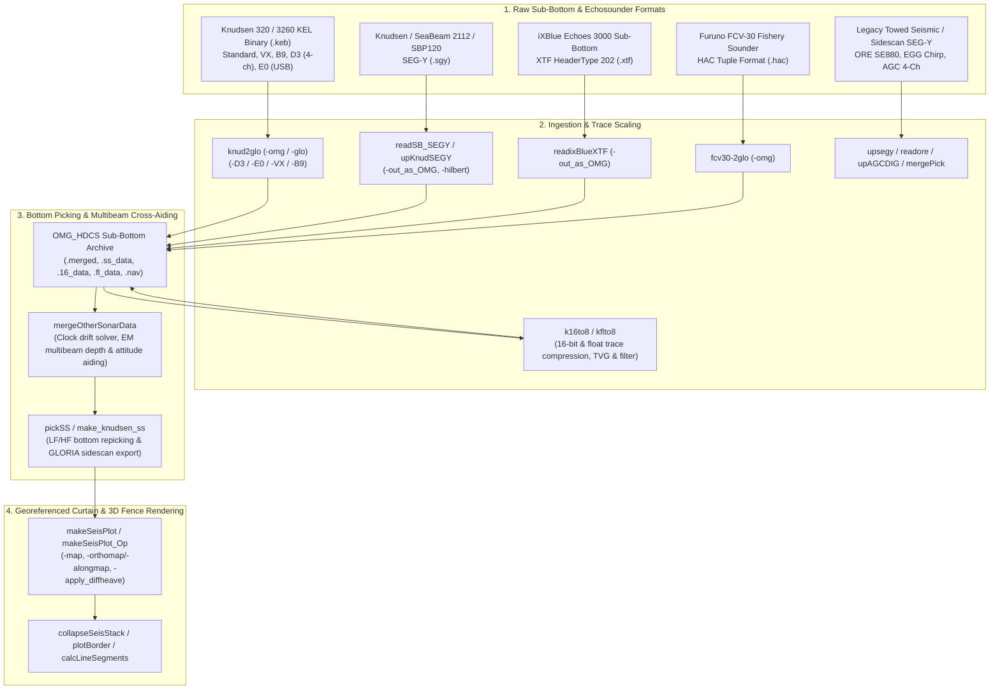
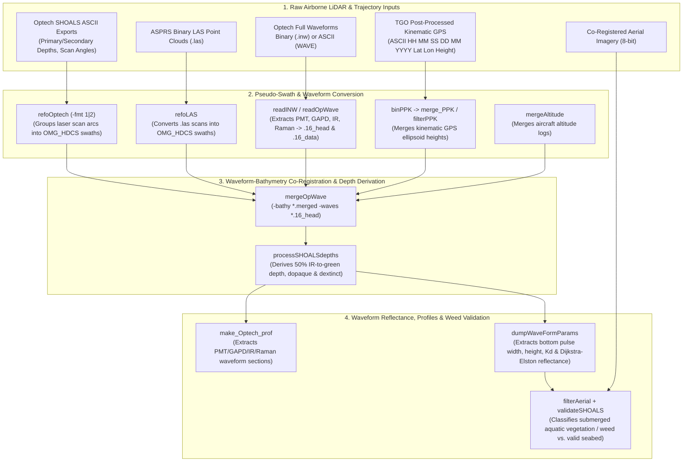

# Sub-Bottom Profiler (Knudsen / SEG-Y) & Bathymetric LiDAR (Optech / LAS) Workflows

Beyond multibeam and sidescan sonars, the Ocean Mapping Group (OMG) codebase includes two complete geophysical and airborne hydrographic processing suites:

1. **Sub-Bottom Profiling & Singlebeam/Sidescan Echosounders (`code/knudsen/` & `code/segy/`)**: Ingests Knudsen 320B/320M/3260 (`.keb`, `.sgy`), SeaBeam 2112 4 kHz SBP (`.sgy`), iXBlue Echoes 3000 (`.xtf`), Furuno FCV-30 (`.hac`), and Huntec/ORE/AGC SEG-Y seismic data into `OMG_HDCS` `.merged` trace archives, performs automated bottom repicking and cross-sonar attitude/depth aiding (`mergeOtherSonarData`), and renders heave-compensated, georeferenced seismic curtain sections (`makeSeisPlot`).
2. **Airborne Bathymetric LiDAR (`code/Optech/`)**: Ingests Optech SHOALS-1000/3000 ASCII surveys, ASPRS binary `.las` point clouds, and full green/IR/Raman laser waveforms (`.inw` / ASCII `WAVE`), merges Post-Processed Kinematic (PPK) GPS trajectories, derives waveform extinction/opaque depths (`processSHOALSdepths`), and extracts benthic reflectance/weed classification grids (`dumpWaveFormParams`, `validateSHOALS`).

---

## Part 1: Sub-Bottom Profiler & Seismic Workflow (`knudsen/` & `segy/`)



### Stage 1: Unpacking Knudsen, SEG-Y, iXBlue & HAC Formats

#### 1. Knudsen 320 / 3260 KEL Binary Envelope Files (`knud2glo`)
`knud2glo` (`code/knudsen/knud2glo.c`) unpacks Knudsen KEL binary envelope files (`.keb`) across all hardware generations—original 1600-sample records, `-VX` / `-B9` packets, and 4-channel USB `-D3` / `-E0` packets—into `OMG_HDCS` `.merged` (default `-omg`) or GLORIA `.glo` (`-glo`) files, plus a `.nav` track and an ASCII HF depth listing:

```bash
# Unpack a 4-channel Knudsen 3260 USB (-E0) file into OMG_HDCS (.merged + .ss_data + .16_data),
# extracting Channel 1 as HF (200 kHz) and Channel 2 as LF (3.5 kHz):
knud2glo \
  -v -omg \
  -E0 -E0_HF 1 -E0_LF 2 -noE0chan 4 \
  -allow_non1600 -fixMSEC \
  -HF_draft 4.2 -LF_draft 4.2 \
  -log -min16_LF 10 -max16_LF 12000 -min16_HF 50 -max16_HF 25000 \
  -out knud_line01 \
  -in 2023_165_0830.keb
```

#### 2. Dynamic Range Compression, Bandpass Filtering & TVG Adjustment (`k16to8`, `kflto8`)
Because sub-bottom traces are logged as 16-bit integers (`.merged.16_data`) or 32-bit floats (`.merged.fl_data`) with high dynamic range, `k16to8` and `kflto8` (`code/knudsen/`) re-scale the traces into 8-bit `.merged.ss_data` without re-reading the raw vendor files. `k16to8` also supports frequency bandpass filtering (`-filter <low_Hz> <high_Hz>`), $40\log R \to 30\log R$ TVG conversion (`-adjustTVG_40to30`), ensonified area correction (`-do_ensonified_area`), and cross-talk ping removal (`-remove_otherTX`):

```bash
k16to8 \
  -v -log \
  -min16 20 -max16 15000 \
  -non1600 \
  -remove_otherTX -max_depth_of_interference 12.0 -tx_threshold 2500 \
  -in knud_line01.merged.16_data \
  -out knud_line01.merged.ss_data
```

#### 3. SEG-Y, iXBlue Echoes 3000 & Furuno FCV-30 Converters
* **`readSB_SEGY`** (`code/segy/readSB_SEGY.c`): Unpacks 32-bit float, 32-bit int, or 16-bit short SEG-Y sub-bottom files (SeaBeam 2112 4 kHz, Kongsberg SBP120 `-sbp120_ll`, SonarWiz heave-embedded SEG-Y `-extract_heave`, and AUV sub-bottom `-get_AUV_depth`), optionally computing a Hilbert transform envelope (`-hilbert`) and writing `OMG_HDCS` `.merged` files (`-out_as_OMG`):

  ```bash
  readSB_SEGY \
    -v -out_as_OMG \
    -isfloat -hilbert -log -log_range 30 \
    -mindepth 20.0 -maxdepth 180.0 -nosam 1600 \
    -in sbp120_line01.sgy \
    -out sbp120_line01
  ```
* **`upKnudSEGY`** (`code/knudsen/upKnudSEGY.c`): Unpacks Knudsen 320 SEG-Y files into 8-bit trace images.
* **`readixBlueXTF`** (`code/knudsen/readixBlueXTF.c`): Extracts `HeaderType 202` sub-bottom traces from iXBlue Echoes 3000 `.xtf` files into `OMG_HDCS` `.merged` (`-out_as_OMG`).
* **`fcv30-2glo`** (`code/knudsen/fcv30-2glo.c`): Converts Furuno FCV-30 `.hac` fishery echosounder files (tuples 20, 30, 40, 901, 9001, 10000) into GLORIA `.glo` or `OMG_HDCS` `.merged` (`-omg`).
* **Legacy SEG-Y Tools** (`code/segy/`): `upsegy` (EGG chirp SEG-Y envelope/phase extractor), `mergePick` (merges digitized seismic picks), `readore` (ORE SE880 multi-channel SEG-Y reader), and `upAGCDIG` (4-channel AGC digitizer SEG-Y to GLORIA converter).

---

### Stage 2: Cross-Sonar Attitude/Depth Aiding & Bottom Picking (`mergeOtherSonarData`, `pickSS`)

#### 1. Aiding Sub-Bottom Profilers with Concurrent Multibeam Data (`mergeOtherSonarData`)
Sub-bottom profilers often suffer from CPU clock drift, missing roll/pitch/heave sensors, or false sub-bottom tracking in soft mud. `mergeOtherSonarData` (`code/knudsen/mergeOtherSonarData.c`) searches concurrent `OMG_HDCS` multibeam `.merged` files, solves for time-varying clock drift (`-auto_delay`, `-running_delay`), and injects the multibeam's nadir depth (`-replace_depth`) and high-accuracy MRU attitude (`-replace_attitude`) into the Knudsen `.merged` file:

```bash
mergeOtherSonarData \
  -v \
  -in knud_line01.merged \
  -auto_delay -running_delay 2 \
  -replace_attitude -replace_depth \
  -tol 2.0 \
  ../multibeam/*.merged
```

#### 2. Automated Bottom Repicking & Sidescan Extraction (`pickSS`, `make_knudsen_ss`)
* `pickSS` (`code/knudsen/pickSS.c`): Re-tracks the seafloor return on the LF (`-lfpick`), HF (`-hfpick`), or blended (`-bothpick`) trace using an adaptive threshold (`-autothresh` or `-pickthresh 50 -pickwin 20 -ofwhich 15`) and updates the `.merged` beam depths (`-replace` / `-replace_both`).
* `make_knudsen_ss` (`code/knudsen/make_knudsen_ss.c`): Converts Knudsen sidescan or dual-channel echosounder `.merged` files into GLORIA `.glo` sidescan traces with optional beam-pattern correction (`-beam_patt <file>`).

---

### Stage 3: Rendering Georeferenced Seismic Curtain Sections (`makeSeisPlot`)

`makeSeisPlot` (`code/knudsen/makeSeisPlot.c`, plus `makeSeisPlot_Op.c` for perspective views) renders publication-quality 8-bit JHC seismic sections from `.merged` sub-bottom datasets:
* **Time-Series or Georeferenced Map Curtain**: Can plot ping-by-ping scroll sections or project traces onto a 2D OMG mapsheet (`-map <sheet.map> -pixel <m> -Zpixel <m>`) either along the mapsheet X-axis (`-alongmap`) or orthographically (`-orthomap`).
* **Lever-Arm Induced Heave & Differential Heave**: Computes and removes lever-arm induced heave (`-RP_to_sonar X Y Z`, `-apply_diffheave`).
* **Bottom-Relative Windowing**: Can render full traces, only water column (`-above`), only sub-bottom (`-below`), or a window around the seafloor pick (`-pre_m 2.0 -above_m 10.0 -below_m 40.0`).

```bash
# Render a georeferenced 3.5 kHz (-lf) sub-bottom seismic curtain along a mapsheet
# from 15 m to 95 m depth with 0.1 m vertical pixel resolution and 3-trace stacking:
makeSeisPlot \
  -v -lf \
  -map fjord_transect.map -pixel 2.0 \
  -mindepth 15.0 -maxdepth 95.0 -Zpixel 0.10 \
  -stack 3 \
  -use_repick \
  -apply_diffheave \
  -out fjord_35kHz_section.8bit \
  -in knud_line01.merged knud_line02.merged

# Generate a vector PostScript/metafile border with time ticks and depth axes:
plotBorder \
  -v \
  -size 80.0 20.0 \
  -depths 95.0 15.0 10.0 \
  -label_sec 120 \
  -in knud_line01.merged \
  -out fjord_35kHz_border.plt
```

When multiple parallel sub-bottom lines are projected onto 3D perspective views using `makeSeisPlot_Op`, `collapseSeisStack` (`code/knudsen/collapseSeisStack.c`) composites the `.perspect`-weighted sections into a single 3D fence diagram.

---

## Part 2: Airborne Bathymetric LiDAR Workflow (`Optech/`)

The `code/Optech/` directory provides a specialized processing pipeline for **Optech SHOALS (Scanning Hydrographic Operational Airborne Lidar Survey)** airborne bathymetric LiDAR systems and standard **ASPRS `.las`** point clouds.



### Stage 1: Converting LiDAR Point Clouds & Waveforms into `OMG_HDCS` Pseudo-Swaths

To leverage OMG's swath editing (`SwathEd`) and gridding (`weigh_grid`) infrastructure, `refoOptech` and `refoLAS` group individual laser shots ("zaps") along each oscillating scanner arc (`SCAN_PLUS` / `SCAN_MINUS`, up to 500 zaps per scan) into `OMG_HDCS` pseudo-swath profiles (`.merged`) and navigation tracks (`.nav`):

```bash
# 1A. Convert Optech SHOALS ASCII export into OMG_HDCS .merged flightline segments:
refoOptech -v -fmt 1 shoals_flight01.txt shoals_f01

# 1B. Or convert an ASPRS binary .las file into OMG_HDCS .merged flightline segments:
refoLAS -v -fmt 1 lidar_tile01.las las_f01

# 2. Unpack Optech binary (.inw) or ASCII full-waveform files (PMT deep green, GAPD shallow green,
#    IR surface return, and Raman channel) into .16_head and .16_data files:
readINW -v shoals_flight01.inw shoals_wave01
# (or for ASCII waveform dumps: readOpWave -v shoals_flight01.wav shoals_wave01)

# 3. Merge the unpacked 4-channel waveforms (.16_head / .16_data) with the .merged bathymetry:
mergeOpWave -v -bathy shoals_f01*.merged -waves shoals_wave01.16_head
```

### Stage 2: Merging Kinematic GPS (PPK) & Deriving Waveform Depths

Because Optech SHOALS exports ellipsoidal heights or incomplete bottom picks in turbid/shallow water, the `Optech/` suite provides dedicated tools to apply Post-Processed Kinematic (PPK) GPS heights and re-derive depths directly from the green/IR laser waveforms:

```bash
# 1. Convert TGO-exported ASCII PPK GPS trajectory into 16-byte binary PPK records and merge into .merged:
binPPK -v trimble_tgo_ppk.txt flight01.ppk
merge_PPK -verbose -merid -65.0 -ppk flight01.ppk shoals_f01*.merged

# 2. Re-derive true water depths from the 50% IR surface return and PMT/GAPD green bottom returns,
#    plus optical opaque depth (dopaque) and extinction depth (dextinct) for weak/deep-water shots:
processSHOALSdepths -v shoals_f01*.merged
```

### Stage 3: Extracting Waveform Parameters, Reflectance & Weed Validation

Once waveforms are attached to the `.merged` files, you can inspect vertical laser curtains, extract benthic optical reflectance, and classify submerged aquatic vegetation (eelgrass/kelp) that causes false shallow LiDAR picks:

* **`make_Optech_prof`** (`code/Optech/make_Optech_prof.c`): Extracts 2D JHC profile images of the detrended PMT (`-pmt`), GAPD (`-gapd`), IR (`-ir`), or Raman (`-raman`) laser waveforms along a specific beam (`-beam 50` or `-nadir_beam`) or scan azimuth (`-azimuth_angle`):

  ```bash
  make_Optech_prof -v -gapd -nadir_beam -bottom_pick shoals_f01*.merged -out flight01_nadir_gapd.prof
  ```
* **`dumpWaveFormParams`** (`code/Optech/dumpWaveFormParams.c`): Extracts ASCII `Lon Lat Parameter` triplets from the PMT or GAPD bottom return pulse, including bottom return peak amplitude (`-height_only`), pulse stretching/width, water-column diffuse attenuation coefficient $K_d$ (`-k_only`, `-k_prof`), and **Dijkstra & Elston (2004) pseudo-reflectance (`-D_E_method`)**:

  ```bash
  dumpWaveFormParams \
    -v -gapd \
    -valid_only -D_E_method \
    -out shoals_benthic_reflectance.xyz \
    shoals_f01*.merged
  ```
* **`validateSHOALS` & `filterAerial`** (`code/Optech/validateSHOALS.c`, `filterAerial.c`): Compares an 8-bit reference grid (benthic reflectance or solar-corrected aerial imagery from `filterAerial`) against an 8-bit bottom-return pulse height grid to classify each pixel into 4 hydrographic validation states:
  1. `reference > ref_thresh && height < height_thresh` $\rightarrow$ **Submerged Weed / Vegetation**
  2. `reference <= ref_thresh && height < height_thresh` $\rightarrow$ **Suspicious Return**
  3. `reference <= ref_thresh && height >= height_thresh` $\rightarrow$ **Valid Seabed Sounding (No Weed)**
  4. `reference > ref_thresh && height >= height_thresh` $\rightarrow$ **No Weed, Potential Hazard**

```bash
validateSHOALS \
  -reference reflectance_grid.8bit -reference_threshold 120.0 \
  -height pulse_height_grid.8bit -height_threshold 85.0 \
  -out shoals_weed_validation.8bit
```
